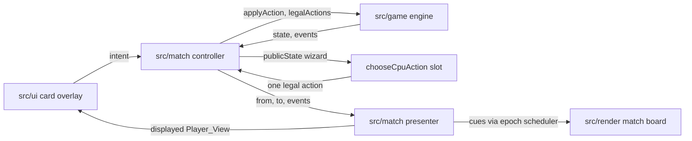
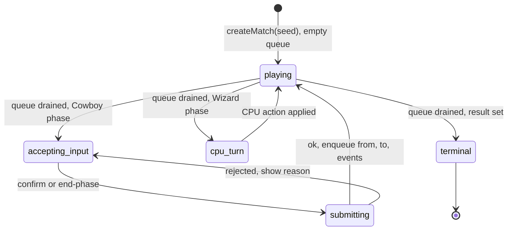

# Design Document

## Overview

Orb Duel adds a card-match mode beside the existing attack demo. Fable's pure JavaScript Engine is the single source of truth. A browser-side Match_Controller holds the full Engine state and sequences human input, CPU turns and playback. The card overlay, Presenter and board view see only the Player_View (`publicState(state, "cowboy")`) and Engine events. Numbers are a working draft, balance unproven.

Fable owns the Engine and CPU. Job C (d01b513) and job D (c1ea873) are integrated into this checkout at b3c77bd. The UI adapts to their exports and event schema. Kiro owns `src/match/`, the card overlay and the match board view. The asset auditor (`scripts/audit-assets.mjs`) is reused as is.

Coordination update by Codex, November 15, 2026: `docs/fable-tasks.md` delegates entry-point wiring, the additive scene export, card-back import/build integration and local browser verification to Kiro. This update changes assignment and readiness information in the Kiro-authored design.

## Architecture

The controller commits Engine state first. The Presenter keeps a displayed copy of the Player_View that lags behind until each event has animated. Nothing outside the controller reads full state.

Controller states:

Restart and mode switch leave any state: the epoch increments, pending work is cancelled and the controller re-enters at `[*]`.

## Components and Interfaces

| Module | Owner | Responsibility |
| --- | --- | --- |
| `src/game/*.js` | Fable job C (committed) | Rules, seeded setup, legal actions, public view |
| `src/game/cpu.js` | Fable job D | CPU choice, wired through the injected slot |
| `src/match/controller.js` | Kiro, new | Full state, seed, epoch, actionIds, turn sequencing, restart |
| `src/match/scheduler.js` | Kiro, new | Epoch-tagged timers, animation frames, impact callbacks, CPU requests |
| `src/match/selection.js` | Kiro, new | UI selection state derived from `legalActions(view, "cowboy")` |
| `src/match/presenter.js` | Kiro, new | Event queue, displayed Player_View, clash grouping, drain check |
| `src/ui/cards.js` | Kiro, new | Deck and hand counts, hand cards, prompts, seed, result, restart |
| `src/render/match-board.js`, `orbs.js` | Kiro, new | Troop pieces via `rigActor`, labelled stand-ins, procedural orbs, `clear()` |
| `src/main.js`, `src/ui/layout.html`, `scripts/build.mjs` | Kiro, coordinator sign-off recorded | Mode switch, match markup, card-back embed |
| `src/render/scene.js`, `rig.js` | Existing; Kiro owns the additive scene export | Stage, tiles, rig helpers, existing attack demo |

### Engine API used (job C)

Exports: `createMatch(seed)`, `applyAction(state, action)` returning `{ok:true, state, events}` or `{ok:false, reason, state}`, `legalActions(stateOrView, side)`, `publicState(state, side)`, and `SIDES`, `CARDS`, `DECKS`, `tributeCost`, `opponent`, `SPELL_DAMAGE`, `SLOT_COUNT`, `BASE_ORBS`, `OPENING_HAND`, `MAX_ROUNDS`, `RULES_VERSION`.

Actions carry `side`, `revision` and an optional `actionId`: summon `{type:"summon", cardId, slot, tributes}`, spell `{type:"spell", cardId, target, destination?}` and `{type:"end-phase"}`. Rejection reasons are Fable's list (match-over, invalid-action, duplicate-action, stale, wrong-side, then summon or spell reasons).

Every event carries the pre-action `revision` and the `actionId` when one was supplied:

| Event | Fields |
| --- | --- |
| `summon` | side, cardId, slot, tributes (slot indexes) |
| `spell` | spell, cardId, caster, target `{side, slot, cardId}`, before, after, destination only when moved |
| `damage` | lane, attacker `{side, slot, cardId}`, target `{kind:"troop", side, slot, cardId}` or `{kind:"base", side}`, amount, before, after |
| `defeat` | side, slot, cardId |
| `phase-end`, `phase-start` | side, round |
| `clash`, `round-start`, `draw` | round; round and startingSide; side |
| `result` | result `{winner, loser, reason, round}` |

The first side's end-phase yields `phase-end`, `phase-start`. The second side's yields `phase-end`, `clash`, all `damage` (lane 0 to 2, cowboy before wizard within a lane), all `defeat`, then either `result` or `round-start`, up to two `draw` and `phase-start`. Victory, Defeat or Draw comes from `publicState(...).result.outcome`.

CPU handoff, as built in `src/match/controller.js`: `chooseCpuAction` defaults to job D's `chooseAction` (c1ea873, integrated at b3c77bd). When playback drains during the Wizard phase, the controller enters `cpu_turn` and schedules one request through the epoch scheduler after `cpuDelay` (600 ms). The request runs only if the epoch and status are unchanged. It passes `publicState(state, "wizard")` and nothing else, checks the epoch and status again after the call, then commits the returned legal action, which already carries the current `revision`, with a new `actionId`. A `null` result or an Engine rejection during the Wizard phase sets the `error` status. Property 6 tests this handoff, and the scripted browser run in `docs/evidence/kiro-match-browser.md` observed `cpu_turn`.

### Selection

States: idle, card-selected, choosing-tribute, choosing-slot, choosing-target, choosing-destination, confirm. Selection never re-implements rules. On card click it filters `legalActions(view, "cowboy")` by `cardId`. Tribute sets, slots, spell targets and destinations offered at each step are those of the remaining matching actions. A troop with no matching summon shows a message: the shortfall when the required tribute exceeds friendly Troops, otherwise the blocking allowance. A slot outside the matching set shows "Slot is invalid". Confirm copies the single matching legal action, adds a new `actionId` and submits it once. Cancel and re-click clear UI state only.

### Presenter and clash timing

For each accepted action the Presenter receives `from` (previous Player_View), `to` (new Player_View) and the events. It deep-copies `from` and patches it as cues play. Each animation has an impact keyframe; at impact the target's displayed value moves from the event's `before` to `after`. The Presenter computes no damage. Fields that events do not carry (a summoned troop's entry, the human's newly drawn card, hand, deck and hand counts, discard, round, allowances, revision, result) are copied from `to` at the event that changes them.

Events from `clash` through the last `damage` form one clash group. All attacks in the group start together. Each impact applies only its own damage event. Impacts on the same target apply in event order, so chained base `before`/`after` values stay monotone. An attack is never skipped or cancelled because its attacker's displayed health reached zero; that model stays with zero orbs. `defeat` removals play only after every attack in the group has finished. A spell defeat removes the troop after the spell's impact cue. A Singularity survivor moves to `destination` after its impact.

Side slot i maps to `stage.tiles[i]` for Cowboys and `stage.tiles[3 + i]` for Wizards.

### Input lock, epoch and cancellation

Hand, slot and end-phase input are ignored unless the controller is in accepting_input. The CPU is asked only after the queue drains.

The controller holds a match `epoch`, incremented on restart and on mode switch. Every timer, animation-frame callback, impact callback and CPU request goes through one scheduler that tags it with the current epoch. On increment the scheduler cancels pending entries, the queue is cleared, selection resets and the renderer's `clear()` removes troops, orbs and result displays. A late callback or CPU result whose epoch is old is dropped before it touches committed state, displayed state or renderer. The Engine's stale-revision check is not enough: a new match restarts at revision 0 with empty `actionIds`, so with the same pinned seed an old action could match the new state and be accepted.

### Seed, demo and shared files

The controller generates a seed with `crypto.getRandomValues(new Uint32Array(1))[0]` and passes it explicitly to `createMatch`. A `?seed=` parameter or the seed field pins an integer seed; non-integer input is refused with a message. The controller records the seed and the match details display it, because `publicState` hides it. Restart uses the pinned seed if one was supplied, otherwise a newly generated one.

The mode switch lives in `src/main.js` and the match markup in `src/ui/layout.html`. Kiro has coordinator sign-off for these integration edits. The match view uses a minimal additive board-setup export from `src/render/scene.js` while preserving `createDuel` (fire, cast, exchange, tiles 1 vs 4, health 100/100, existing event names). Kiro imports the approved card back into `assets/cards/card-back.png` and wires `scripts/build.mjs`. Sheriff, Mounted Billy, Skeleton and Dragon appear as labelled temporary tokens. Billy and Wizard use the existing procedural animation. The proposed job F polish is an unassigned follow-up after the playable interface.

## Data Models

Committed state is Fable's plain JSON: `seed`, `revision`, `rng`, `round`, `startingSide`, `activeSide` (null once over), `allowances[side].{summonUsed, castUsed}`, `actionIds`, `result`, and per side `baseOrbs`, `deck`, `hand`, `board[3]` of null or `{cardId, health}`, `discard`. Only the controller holds it.

Player_View: `{viewer, revision, round, startingSide, activeSide, allowances, result, sides}`, where `result` adds `outcome` and the opponent side has `handCount` and `deckCount` but no hand. Displayed state has the same shape.

UI-only state: `{mode, epoch, seed, seedPinned, controllerState, selection, queue, displayed}`. It is never fed back into the Engine.

## Correctness Properties

*A property is a characteristic or behavior that should hold true across all valid executions of a system: a formal statement about what the system should do. Properties bridge human-readable requirements and machine-checkable guarantees.*

Engine properties (card ownership, replay determinism, rejected actions change nothing, tribute validity, Engine health bounds) are verified by Fable's `tests/game/*.test.js` (30 tests on d01b513, seeded invariant walks over seeds 0 to 99). Kiro reuses them as regression and does not duplicate them (Requirements 1, 3, 6, 7, 8, 10, 11.1 to 11.3). The properties below are Kiro's.

### Property 1: Selection never touches the Engine
For any Player_View and any click sequence, committed state is unchanged until confirm, a cancel or an input outside accepting_input submits nothing, and confirm submits exactly one action equal to a member of `legalActions(view, "cowboy")` plus a fresh `actionId`.
**Validates: Requirements 2.2, 2.3, 2.4, 2.5, 4.1, 4.2, 4.3, 4.4, 4.5, 12.5**

### Property 2: Presenter fidelity
For any seed and legal action walk, the Presenter receives only Player_Views and events, each orb count changes only at its event's impact cue from `before` to `after`, and at drain the displayed state deep-equals `to`.
**Validates: Requirements 2.1, 5.1, 5.2, 5.3, 5.5, 12.1, 12.2, 12.3**

### Property 3: Clash completeness
For any clash group, every damage event gets exactly one attack and one impact, including attackers already at zero displayed health, and every defeat removal follows the last impact of the group. Spell defeats follow the spell impact.
**Validates: Requirements 5.6, 5.7, 5.8**

### Property 4: Displayed health bounds
For any displayed state during playback, a troop shows 1 to max orbs, or 0 orbs only between its fatal impact and its removal, and each Base shows 0 to 5 orbs.
**Validates: Requirements 5.1, 5.2, 5.6**

### Property 5: Cancellation
For any seed and any cut point during playback, after a restart or mode switch no callback or CPU result from an older epoch changes the new match's committed state, displayed state or renderer calls, and the renderer is empty before the new state is shown.
**Validates: Requirements 11.5, 12.7, 12.8**

### Property 6: CPU information limit
For any seed, every value passed to `chooseCpuAction` deep-equals `publicState(state, "wizard")`, it is called only with an empty queue, and only its returned action is submitted.
**Validates: Requirements 9.2, 12.6**

## Error Handling

Engine rejections return `{ok:false, reason, state}`; the controller shows the reason and returns to accepting_input. Invalid slots and tribute shortfalls are caught in selection before submission. The Presenter throws a development error naming the type for an unsupported event, and naming the first differing field path when the drained displayed state differs from `to`. Playback stops and the error is shown; there is no silent skip or resync. A late old-epoch callback is dropped. A non-integer pinned seed is refused before `createMatch`. A missing model shows a labelled temporary stand-in, and card statistics never depend on which models exist.

## Testing Strategy

PBT applies to selection, Presenter, scheduler and controller logic. It does not apply to rendering, layout or asset quality. No PBT library is installed and package files belong to the coordinator, so properties run as seeded loops over seeds 0 to 99 (100 iterations), drawing walks from `legalActions`, with a fake renderer and a fake scheduler. A failure prints its seed. Each test is tagged `Feature: orb-duel, Property N: <property text>`, one test per property.

- Kiro tests: `node --test "tests/match/*.test.js"`. The glob form is required; the bare directory form fails on Node 26 per Fable's note.
- Examples: generated and pinned seeds reach `createMatch`, the seed is displayed, restart seed choice, outcome to Victory, Defeat or Draw, slot-to-tile mapping, an unsupported event type throws, seeds 14, 27 and 47 play with no mulligan.
- Regression: Fable's `node --test "tests/game/*.test.js"`, and `npm run check` for the unchanged attack demo.
- Assets: `node scripts/audit-assets.mjs` on any new troop export. It cannot prove grip or visual quality.
- Browser interaction: one scripted Chrome run (seed 0, 2026-11-15, 7:44 PM PST) is recorded in `docs/evidence/kiro-match-browser.md`. Scenarios it did not cover are listed there as pending.

### Unresolved dependencies

- Approved card front file (OQ-A) and production card textures.
- Models and animation for Sheriff, Mounted Billy, Skeleton and Dragon (OQ-C).
- Balance of 12-card decks and nine rounds (OQ-B).
