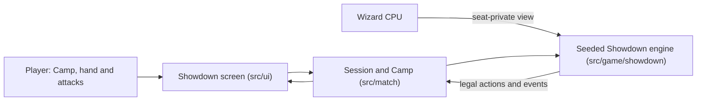

# Cowboys vs. Wizards

**A haunted-Western card duel: cowboys against wizards, where you choose every attack and your troops shield your Base.** It takes what long-running card games already proved (tribute summons, spells that answer a board, a graveyard, a deck you build) and keeps a duel short and easy to read.

## Status on November 20, 2026

The game is **Showdown**, and it is the only supported game in this repository. The rules are being built first, in a plain "graybox" page: a flat board, text cards and a duel log. [Play it in the browser](https://alejandro-publius.github.io/cowboys-vs-wizards/): **Play** opens the Camp, which starts the Trail of duels and, after it, the rivals, Wanted bounties, packs, the deck builder with a side deck, best of three and two players. The same page is at [/graybox/](https://alejandro-publius.github.io/cowboys-vs-wizards/graybox/) for older links. The [full Showdown reference page](https://alejandro-publius.github.io/cowboys-vs-wizards/showdown/) is kept, and [what is in it](prototypes/showdown/README.md) is listed there.

The earlier three-lane duel and its illustrated 3D build are retired. Old `/3d/` links lead to Showdown, and an old `?mode=` address opens the Showdown menu. The last playable lane and 3D source is preserved in Git history at `main` commit `ea183ee29dbd` (`git checkout ea183ee29dbd`). Saved lane progress does not carry into Showdown: a lane capture shows in the Camp as a keepsake only ([keepsake ruling](docs/design/release-line.md#current-status-november-20-supersedes-the-november-19-1015-pm-handoff)). The 3D layer will be rebuilt on top of Showdown once the rules are locked, because motion is expensive to change.

No first-time human player has tested the current rules yet. Every balance figure in this repository comes from bot play. The [release line and scoreboard](docs/design/release-line.md) says what is in the game, what is waiting on a playtest, and what was cut. Fable's game decisions are posted on [issue 143](https://github.com/alejandro-publius/cowboys-vs-wizards/issues/143).

## Card art library

The [Showdown art direction catalog](prototypes/showdown/ART-DIRECTION.md) has prompts for all 29 cards, a shared style guide, 18 environment and prop briefs, and 13 model sheets. The [Sheriff](assets/cards/sheriff-card.webp) and [Dragon](assets/cards/dragon-card.webp) paintings are the style references.

Regenerate it after editing the briefs in [`prototypes/showdown/art.js`](prototypes/showdown/art.js):

```sh
node prototypes/showdown/export-art.mjs
```

The [Showdown card spreadsheet](prototypes/showdown/cards.csv) uses the same visual direction. Regenerate it with `node prototypes/showdown/export-cards.mjs`.

## Play

Use Node.js 22.18 or later.

```sh
npm ci
npm run build
```

Open `dist/cowboys-vs-wizards-board-duel.html` in a desktop browser. **Play** opens the Showdown Camp. `?seed=N` fixes every deal started from the Camp, and `?practice=0` or `?practice=60` opens a fixed Boot Hill practice deal. Any old lane address (`?mode=lanes`, `match`, `ride-out`, `practice-*`, `fire-arc`) opens the same Showdown menu.

`npm run build -- --web` writes the same single file to `dist/web/index.html`, and `npm run build -- --hosted` writes the Pages copy there. `node prototypes/showdown/build.mjs` writes the full Showdown page to `dist/showdown.html`.

`node scripts/stage-pages.mjs` stages the whole site in `dist/web/` exactly as the Pages workflow does: Showdown at `/` and `/graybox/`, the Showdown reference page at `/showdown/`, and old `/3d/` links leading to Showdown. `node scripts/check-pages-tree.mjs --browser` serves that tree under `/cowboys-vs-wizards/` and checks it.

Every Showdown card is in the [Showdown card spreadsheet](prototypes/showdown/cards.csv), and the rules are in the [rulebook](prototypes/showdown/RULEBOOK.md). `docs/cards.csv` and `docs/rules.csv` describe the retired lane duel and are kept as history.

## How it is made

Three tools share the work, and each is credited for what it did.

- **Fable (Claude Code)** leads the design: mechanics, progression and engine contracts. Its briefs are in [docs/design](docs/design/README.md).
- **Kiro** builds those briefs, integrates them and runs the checks. See [Built with Kiro](#built-with-kiro).
- **Codex** coordinates, reviews and verifies in the browser.

## Verify

Start with the normal Showdown Play path. Build once with `npm run build`; each browser check takes the built file.

| What you need | Command |
| --- | --- |
| Play opens the Camp; Boot Hill won with clicks; seat privacy; every retired lane address opens Showdown | `node scripts/browser-showdown-check.mjs dist/cowboys-vs-wizards-board-duel.html` |
| Camp modes: rivals, Wanted, packs, deck builder and side deck, best of three, two players, save code, Start over | `node scripts/browser-showdown-modes-check.mjs dist/cowboys-vs-wizards-board-duel.html` |
| Trail duels paid and kept after reload; lane keepsakes shown, not carried | `node scripts/browser-showdown-trail-check.mjs dist/cowboys-vs-wizards-board-duel.html` |
| Keyboard-only and mouse play | `node scripts/browser-showdown-keyboard-check.mjs dist/cowboys-vs-wizards-board-duel.html` |
| Combat cues | `node scripts/browser-showdown-cues-check.mjs dist/cowboys-vs-wizards-board-duel.html` |
| Showdown rules | `node --test prototypes/showdown/rules.test.js prototypes/showdown/contract.test.js tests/game/showdown-presenter.test.js` |
| Tests as run on every pull request | `npm test` |
| The staged Pages site, as CI checks it (add `--browser` for Chrome) | `node scripts/stage-pages.mjs --commit <sha>`, then `node scripts/check-pages-tree.mjs --commit <sha>` |
| Which commit the live site is (after a Pages deploy) | `curl https://alejandro-publius.github.io/cowboys-vs-wizards/build.json`; CI compares it and the live `index.html` digest, also at `/graybox/`, with the built release ([evidence](docs/evidence/kiro-build-identity.md)) |

The saved **showdown-practice-replay** Workflow replays Boot Hill deals `?practice=0` and `?practice=60` in headless Chrome. Run `node scripts/verify-duel.mjs --browser` to test the staged Showdown site and the `/3d/` redirect. See the [Kiro write-up](docs/kiro-brag-sheet.md) for specs, hooks, tests, and replay evidence.

## Architecture at a glance

The Showdown engine decides which moves are legal and what damage happens; the screen shows those decisions. This keeps every seeded deal reproducible.



[Architecture and source ownership](docs/ARCHITECTURE.md) · [Current verified state and next priorities](docs/PROJECT-STATUS.md) · [Index of all documents](docs/README.md)

## Built with Kiro

Kiro's Requirements-First Orb Duel spec, custom agent, workspace steering, hooks, replay Workflow, and review Power/MCP are part of this repository—not a narrative added after the fact. The Orb Duel spec and its replay receipts record the retired lane build and stay as history. The Kiro work is distinguished from Fable's match rules/CPU and Codex's integration and verification.

[Follow the judge evidence trail](docs/JUDGE-GUIDE.md) · [Kiro usage and receipts](docs/kiro-brag-sheet.md) · [Actual build log](docs/kiro-build-log.md) · [Active closeout queue](docs/kiro-closeout-queue.md) · [Research/source register](docs/kiro-source-register.md)

For ongoing balance review, the separate [Night Watch Kiro Crew app](https://github.com/alejandro-publius/cowboys-vs-wizards-night-watch) compares committed game revisions on matching CPU seeds, records changes and drafts issue reports. It is an optional local development tool, **not** part of the shipped browser game. [Crew run evidence](docs/evidence/kiro-night-watch.md).

## Code map

| Path | Owns |
| --- | --- |
| `src/game/showdown/` | Showdown rules, cards, screen contract, progress and save codes |
| `src/app.js` | Entry point: the Showdown title, Camp, deck builder and duel screens |
| `src/ui/showdown-*.js`, `src/ui/showdown.css` | Showdown screen, Camp, builder and cues |
| `src/match/showdown-*.js` | Showdown session, campaign and match flow |
| `prototypes/showdown/` | Rulebook, reference page, card spreadsheet and the [art direction](prototypes/showdown/ART-DIRECTION.md) |
| `.kiro/specs/duel-card-pipeline/cards/` | Card specs that the Showdown card table reads |
| `assets/` | Optimized Tripo models, card illustrations and media (source assets, kept) |
| `scripts/`, `tests/` | Build, replay, simulation and verification |
| `.kiro/`, `docs/` | Workspace guidance, requirements, research and evidence |

Legacy headless utilities still support archived rules experiments and reading old profile keepsakes. The playable lane build is in Git history at `ea183ee29dbd`.

Contributing with an AI agent? Start with [AGENTS.md](AGENTS.md), then use the [task-specific file router](docs/AGENT-ROUTER.md) rather than scanning the whole repository. Work on one owned area in a separate worktree and run its affected check. The engine decides outcomes. The screen renders the events and their before and after values.

## Assets and attribution

The models and clips in `assets/` are kept as source assets for the Showdown 3D layer. Dragon and Mounted Billy have articulated Blender attack clips. Skeleton has its fitted Tripo mesh. Sheriff has the approved sourced Mixamo idle. See the [animation plan](docs/character-animation-plan.md) before adding clips or replacing an export.

The pinned Lucca Cerf references and their MIT license are in [docs/references/lucca-character-factory](docs/references/lucca-character-factory). The [build log](docs/kiro-build-log.md) attributes work by Kiro, Fable, Codex, Tripo and the user.

[Verified closeout deployment](docs/evidence/kiro-closeout-deployment.md)
