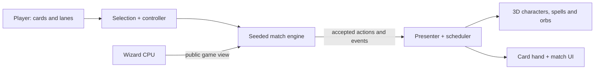

# Cowboys vs. Wizards

**A haunted-Western card duel: cowboys against wizards, where you choose every attack and your troops shield your Base.** It takes what long-running card games already proved (tribute summons, spells that answer a board, a graveyard, a deck you build) and keeps a duel short and easy to read.

## Status on November 20, 2026

The rules are being built first, in a plain "graybox" page: a flat board, text cards and a duel log. Showdown is the fight this game is being built on, and the graybox is now Showdown only. [Play it in the browser](https://alejandro-publius.github.io/cowboys-vs-wizards/): **Play** opens the Camp, which starts the Trail of duels and, after it, the rivals, Wanted bounties, packs, the deck builder with a side deck, best of three and two players. The same page is at [/graybox/](https://alejandro-publius.github.io/cowboys-vs-wizards/graybox/) for older links. The [full Showdown reference page](https://alejandro-publius.github.io/cowboys-vs-wizards/showdown/) is kept, and [what is in it](prototypes/showdown/README.md) is listed there.

The earlier three-lane duel is no longer playable in the graybox; an old `?mode=` address opens the Showdown menu. It survives only in the [earlier illustrated 3D build](https://alejandro-publius.github.io/cowboys-vs-wizards/3d/), which holds the models, animation and board and is labelled as the earlier build. The 3D layer goes on top of Showdown once the rules are locked, because motion is expensive to change. (These site paths apply once issue 143 slice 3 is merged and deployed.)

No first-time human player has tested the current rules yet. Every balance figure in this repository comes from bot play. The [release line and scoreboard](docs/design/release-line.md) says what is in the game, what is waiting on a playtest, and what was cut. Fable's game decisions are posted on [issue 143](https://github.com/alejandro-publius/cowboys-vs-wizards/issues/143).

## What the earlier 3D lane build has

- **The duel.** Twelve-card decks, three lanes, one summon and one spell a turn, tributes for stronger troops, and both sides striking at once.
- **A title menu** with settings, achievements, a deck workbench and the Wanted board.
- **The models and motion:** Sheriff, Wizard, Dragon, Mounted Billy and Skeleton, and the original attack demo at `?mode=demo`.

Every card is listed in the [card spreadsheet](docs/cards.csv), and the rules in the [rules sheet](docs/rules.csv).

## Play

Use Node.js 22.18 or later.

```sh
npm ci
npm run build
```

Open `dist/cowboys-vs-wizards-board-duel.html` in a desktop browser. **Play** opens the Showdown Camp. `?seed=N` fixes every deal started from the Camp. Any old lane address (`?mode=lanes`, `match`, `ride-out`, `practice-*`, `fire-arc`) opens the same Showdown menu.

`npm run build -- --web` writes the same single file to `dist/web/index.html`, and `npm run build -- --hosted` writes the Pages copy there. `node prototypes/showdown/build.mjs` writes the full Showdown page to `dist/showdown.html`.

`npm run build:art` builds the earlier illustrated 3D duel and attack demo at the same path, `dist/cowboys-vs-wizards-board-duel.html`, replacing the graybox there. That build needs WebGL 2 and includes the models and card art. `npm run build:art -- --web` writes it with content-hashed assets to `dist/web/3d/`.

`node scripts/stage-pages.mjs` stages the whole site in `dist/web/` exactly as the Pages workflow does: the graybox at `/` and `/graybox/`, the Showdown page at `/showdown/` and the 3D build at `/3d/`. `node scripts/check-pages-tree.mjs --browser` serves that tree under `/cowboys-vs-wizards/` and checks it.

## How it is made

Three tools share the work, and each is credited for what it did.

- **Fable (Claude Code)** leads the design: mechanics, progression and engine contracts. Its briefs are in [docs/design](docs/design/README.md).
- **Kiro** builds those briefs, integrates them and runs the checks. See [Built with Kiro](#built-with-kiro).
- **Codex** coordinates, reviews and verifies in the browser.

## Verify

Start with the normal Showdown Play path. Build once with `npm run build`; each browser check takes the built file.

| What you need | Command |
| --- | --- |
| Play opens the Camp; Boot Hill won with clicks; seat privacy; every retired lane address opens Showdown | `node scripts/browser-showdown-check.mjs dist/cowboys-vs-wizards-board-duel.html` |
| Camp modes: rivals, Wanted, packs, deck builder and side deck, best of three, two players, save code, Start over | `node scripts/browser-showdown-modes-check.mjs dist/cowboys-vs-wizards-board-duel.html` |
| Trail duels paid and kept after reload; lane keepsakes shown, not carried | `node scripts/browser-showdown-trail-check.mjs dist/cowboys-vs-wizards-board-duel.html` |
| Keyboard-only and mouse play | `node scripts/browser-showdown-keyboard-check.mjs dist/cowboys-vs-wizards-board-duel.html` |
| Combat cues | `node scripts/browser-showdown-cues-check.mjs dist/cowboys-vs-wizards-board-duel.html` |
| Accessibility, touch targets, text size and search and link-preview tags on every graybox screen, at desktop and phone sizes ([results](docs/evidence/claude-measurable-scores.md)) | `node prototypes/showdown/build.mjs`, then `npx -y -p playwright-core@1.64.1 node scripts/browser-page-audit.mjs dist/cowboys-vs-wizards-board-duel.html dist/showdown.html` |
| Game, presenter and asset tests, as run on every pull request | `npm test` (the same as `node scripts/verify-duel.mjs`) |
| The staged Pages site, as CI checks it (add `--browser` for Chrome, including `/3d/` model loading) | `node scripts/stage-pages.mjs --commit <sha>`, then `node scripts/check-pages-tree.mjs --commit <sha>` |
| Which commit the live site is (after a Pages deploy) | `curl https://alejandro-publius.github.io/cowboys-vs-wizards/build.json`; CI compares it and the live `index.html` digest, also at `/graybox/`, with the built release ([evidence](docs/evidence/kiro-build-identity.md)) |
| Earlier 3D build: the tests, a fresh illustrated build and an eight-step Chrome replay | `node scripts/verify-duel.mjs --browser` |
| Earlier 3D build: attack demo geometry, grip and event order | `npm run check` |
| A seeded lane rules trace | `node scripts/play-match.mjs --seed 60` |

The older lane harnesses (`browser-menu-check`, `browser-webkit-smoke` and the other lane `scripts/browser-*.mjs`) drive only the earlier 3D build at `/3d/`; [docs/AGENT-ROUTER.md](docs/AGENT-ROUTER.md#earlier-illustrated-3d-build-lane-rules-3d) lists which ones are current and how to point them at it.

The Chrome check on macOS writes the receipt and screenshots to `.artifacts/kiro/replay/` when invoked through `verify-duel.mjs`. The saved **orb-duel-replay** Workflow runs the same command. See the [Kiro write-up](docs/kiro-brag-sheet.md) for the Spec, hooks, tests, review Power and MCP evidence.

## Architecture at a glance

The rules engine decides which moves are legal and what damage happens; the renderer shows those decisions at the correct moment. This keeps gameplay reproducible while animated attacks can overlap.



[Architecture and source ownership](docs/ARCHITECTURE.md) · [Current verified state and next priorities](docs/PROJECT-STATUS.md) · [Index of all documents](docs/README.md)

## Built with Kiro

Kiro's Requirements-First Orb Duel spec, custom agent, workspace steering, hooks, replay Workflow, and review Power/MCP are part of this repository—not a narrative added after the fact. The Kiro work is distinguished from Fable's match rules/CPU and Codex's integration and verification.

[Follow the judge evidence trail](docs/JUDGE-GUIDE.md) · [Kiro usage and receipts](docs/kiro-brag-sheet.md) · [Actual build log](docs/kiro-build-log.md) · [Active closeout queue](docs/kiro-closeout-queue.md) · [Research/source register](docs/kiro-source-register.md)

For ongoing balance review, the separate [Night Watch Kiro Crew app](https://github.com/alejandro-publius/cowboys-vs-wizards-night-watch) compares committed game revisions on matching CPU seeds, records changes and drafts issue reports. It is an optional local development tool, **not** part of the shipped browser game. [Crew run evidence](docs/evidence/kiro-night-watch.md).

## Code map

| Path | Owns |
| --- | --- |
| `src/game/` | Seeded rules, legal actions, public views and CPU |
| `src/match/` | Selection, controller, scheduler and event playback |
| `src/render/` | Three.js scene, rigs, orbs and combat cues |
| `src/ui/` | Illustrated hand, interactive overlay and menus |
| `src/app.js` | Graybox entry point: the Showdown title, Camp, deck builder and duel screens |
| `src/game/showdown/` | Showdown rules, cards, screen contract, progress and save codes |
| `src/main.js` | Earlier illustrated 3D build: boot, mode switching and frame loop (lane rules) |
| `assets/` | Optimized Tripo models, card illustrations and media |
| `scripts/`, `tests/` | Build, replay, simulation and verification |
| `.kiro/`, `docs/` | Workspace guidance, requirements, research and evidence |

Contributing with an AI agent? Start with [AGENTS.md](AGENTS.md), then use the [task-specific file router](docs/AGENT-ROUTER.md) rather than scanning the whole repository. Work on one owned area in a separate worktree and run its affected check. The engine decides outcomes. The presenter renders the events and their before and after values.

## Assets and attribution

Dragon and Mounted Billy play articulated Blender attack clips. Skeleton uses its fitted Tripo mesh with the duel’s summon, hit and defeat cues. Billy and Wizard use procedural rigs. Sheriff combines the approved sourced Mixamo idle with the existing procedural draw/fire sequence and runtime transition blending. See the [animation plan](docs/character-animation-plan.md) before adding clips or replacing an export.

The build includes Three.js (MIT) and Rapier (Apache-2.0) notices. The pinned Lucca Cerf references and their MIT license are in [docs/references/lucca-character-factory](docs/references/lucca-character-factory). The [build log](docs/kiro-build-log.md) attributes work by Kiro, Fable, Codex, Tripo and the user.

[Verified closeout deployment](docs/evidence/kiro-closeout-deployment.md)
