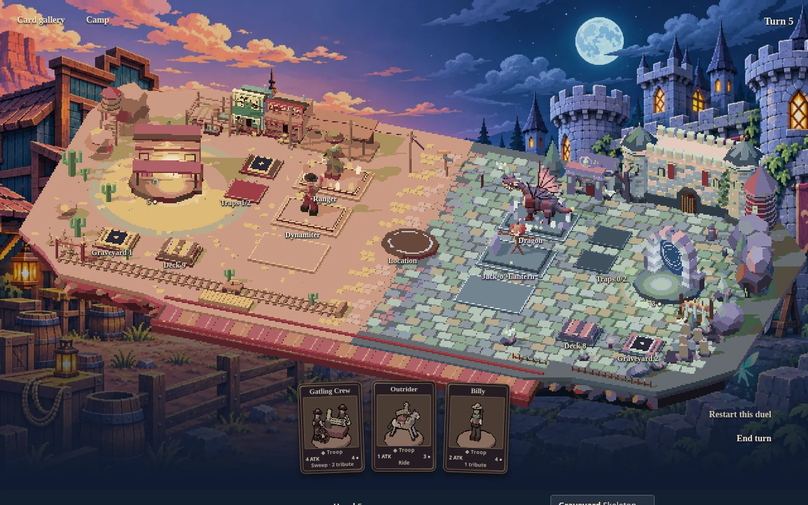
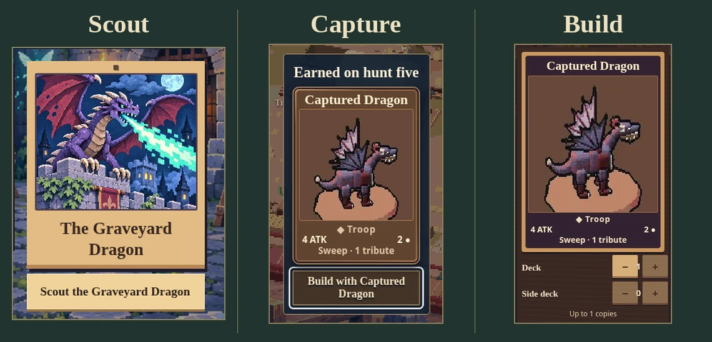
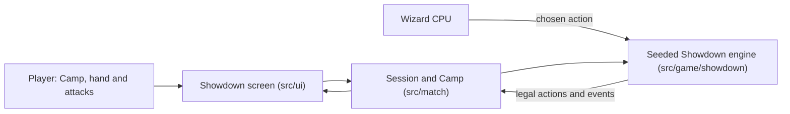

# Cowboys vs. Wizards: Showdown

Ride out from Boot Hill with a 16-card deck. Deadeye can't target the Lantern Wraith. The Graveyard Dragon can take an orb from every troop beside the one it attacks. Clear six Trail stops and beat either boss in five hunts to earn its card for your deck.

**[Play Showdown](https://alejandro-publius.github.io/cowboys-vs-wizards/)** · [Scout the Graveyard Dragon](https://alejandro-publius.github.io/cowboys-vs-wizards/?room=wanted) · [Visit the Night Shift Saloon](https://alejandro-publius.github.io/cowboys-vs-wizards/?saloon=review)

[](https://alejandro-publius.github.io/cowboys-vs-wizards/?turn=dragon-c5)

<a id="play-showdown"></a>

## From a Wanted poster to your deck

| If you have… | Take this route |
| --- | --- |
| One minute | Open **Wanted** and tap the Graveyard Dragon poster to scout with the Ranger. Pick a target before revealing the recorded move, then play the turn yourself. Tap the Lantern Wraith poster to study its Ghostly ability. [Wanted board](https://alejandro-publius.github.io/cowboys-vs-wizards/?room=wanted) |
| Time for a campaign | Choose **Camp → Boot Hill**. The first win earns two Covered Wagons. Finish the Trail to hunt either boss. Five victories over the same boss earn its card. Open the captured portrait to watch its move, then choose **Build with** and replace one card in your 16. [Enter Camp from the title](https://alejandro-publius.github.io/cowboys-vs-wizards/) |
| A second player | Open **Even Fight** for two players sharing one device and pass the screen between turns. At the Saloon’s back table, Boot Hill Poker deals a separate five-card game against the Wizard. [Two-player Showdown](https://alejandro-publius.github.io/cowboys-vs-wizards/?even-fight=two) · [Boot Hill Poker](https://alejandro-publius.github.io/cowboys-vs-wizards/poker/) |

<picture>
  <source media="(max-width: 640px)" srcset="docs/media/frontier-dragon-capture-mobile.webp">
  
</picture>

The full campaign saves in your browser. The Dragon practice positions replay recorded deals and leave your collection alone. You can also try the Outrider’s opening choice or use the lightweight board. [Ride or Fight?](https://alejandro-publius.github.io/cowboys-vs-wizards/?outrider=case-e) · [Lightweight Camp](https://alejandro-publius.github.io/cowboys-vs-wizards/graybox/) · [Rules and cards](prototypes/showdown/RULEBOOK.md)

| What you see | What it means for your next move |
| --- | --- |
| Five tally marks under a Wanted portrait | Each filled mark records a hunt you won against that boss. Scouting leaves the tally alone. |
| **Captured** stamped across the portrait | Open the portrait to see the Cowboy card you earned. Choose **Build with** to put it in your deck. |
| **Ghostly** on the Wraith | A spell that picks a target, such as Deadeye, can't choose it. Once your captured Wraith faces the Wizard, Hellfire can still take an orb from it. |

At the **Night Shift Saloon → Forge shelf**, cast Hellfire on a Sheriff standing across from your Skeleton. Choose what “every troop” should mean, see exactly whose orbs changed, then replay the same deal with the other wording. [Playtest and referee results](docs/evidence/player-card-forge/hellfire-witness.md)

To run a first-time playtest, build the local moderator with `node experiments/dragon-discovery/build.mjs`. It starts each person at the title, times their first Ranger target, and lets you record how they think the Dragon is earned. [Five-player protocol](experiments/dragon-discovery/PROTOCOL.md)

<a id="how-kiro-reviews-a-card-change"></a>

## Inside the Night Shift

The Cautious Sheriff sets traps. The Reckless Wizard casts first. Each sends a playbook across the pixel arena to Kiro’s referee, which plays the same eight deals from both starting seats. The rows below show how a player’s card request became Dusty Pete, how Billy’s balance change was tested, and when a release review stops.

<picture>
  <source media="(max-width: 940px)" srcset="docs/media/frontier-night-shift-mobile.svg">
  <source media="(max-width: 1150px)" srcset="docs/media/frontier-night-shift.svg">
  
</picture>

[Full-size animated map](docs/media/frontier-workflow-map.svg) · [Expanded diagram](docs/media/frontier-night-shift.svg) · [Still map](https://raw.githubusercontent.com/alejandro-publius/cowboys-vs-wizards/main/docs/media/frontier-workflow-map.svg#still) · [Workflow evidence](docs/evidence/frontier-workflows.md) · [Native Kiro CLI capture](docs/evidence/kiro-night-shift-native.png)

[Judge walkthrough](docs/JUDGE-GUIDE.md) · [Current build and review status](docs/PROJECT-STATUS.md#current-build) · [Live build manifest](https://alejandro-publius.github.io/cowboys-vs-wizards/build.json)

## Local build

Use Node.js 22.18 or later and run these commands from the repository root.

```sh
npm ci
npm run build -- --diorama --contest
```

Open `dist/cowboys-vs-wizards-showdown-3d.html` in a browser to play the illustrated contest build offline. Use `?seed=N` for a reproducible deal. Fixed Boot Hill practice deals are available at `?practice=0` and `?practice=60`.

| Build or check | Command | Output |
| --- | --- | --- |
| Lightweight board | `npm run build` | `dist/cowboys-vs-wizards-board-duel.html` |
| Full Pages site, including Poker | `node scripts/stage-pages.mjs --commit "$(git rev-parse HEAD)"` | `dist/web/` |
| Play the staged site locally | `python3 -m http.server 8000 --directory dist/web` | Open `http://localhost:8000/` |
| Verify the staged routes and play them in Chrome | `node scripts/check-pages-tree.mjs --browser` | Checks the page identity, links, table controls and Saloon route |

## How it is made

Codex now maintains the build and the pull request queue. The repository also records the original design and implementation work.

- **Fable (Claude Code)** designed mechanics, progression and engine contracts. Its briefs are in [docs/design](docs/design/README.md).
- **Kiro** implemented the gameplay briefs and ran the recorded balance, rules and release checks. See [Built with Kiro](#built-with-kiro).
- **Codex** integrates current changes, reviews the game against its rules and tests the published build in a browser.

## Verify

Use `npm test` for the repository suite. The Camp and keyboard checks below take the lightweight board built with `npm run build`. The Pages check takes the complete staged site.

| What you need | Command |
| --- | --- |
| Play opens the Camp; Boot Hill won with clicks; seat privacy; every retired lane address opens Showdown | `node scripts/browser-showdown-check.mjs dist/cowboys-vs-wizards-board-duel.html` |
| Camp modes: rivals, Wanted, packs, deck builder and side deck, best of three, two players, save code, Start over | `node scripts/browser-showdown-modes-check.mjs dist/cowboys-vs-wizards-board-duel.html` |
| Trail duels paid and kept after reload; lane keepsakes shown, not carried | `node scripts/browser-showdown-trail-check.mjs dist/cowboys-vs-wizards-board-duel.html` |
| Keyboard-only and mouse play | `node scripts/browser-showdown-keyboard-check.mjs dist/cowboys-vs-wizards-board-duel.html` |
| Combat cues | `node scripts/browser-showdown-cues-check.mjs dist/cowboys-vs-wizards-board-duel.html` |
| Showdown rules | `node --test prototypes/showdown/rules.test.js prototypes/showdown/contract.test.js tests/game/showdown-presenter.test.js` |
| Tests as run on every pull request | `npm test` |
| The staged Pages site, as CI plays it in Chrome | `node scripts/stage-pages.mjs --commit <sha>`, then `node scripts/check-pages-tree.mjs --commit <sha> --browser`. On Linux, set `CHROME` to the Chrome executable. |
| Which commit the live site is (after a Pages deploy) | `curl https://alejandro-publius.github.io/cowboys-vs-wizards/build.json`; CI compares it and the live `index.html` digest, also at `/3d/`, with the built release ([evidence](docs/evidence/kiro-build-identity.md)) |

The saved **showdown-practice-replay** Workflow replays Boot Hill deals `?practice=0` and `?practice=60` in headless Chrome. Run `node scripts/verify-duel.mjs --browser` to test the staged Showdown site and its `/3d/` compatibility route. See the [Kiro write-up](docs/kiro-brag-sheet.md) for specs, hooks, tests, and replay evidence.

## Architecture at a glance

The Showdown engine decides which moves are legal and what damage happens; the screen shows those decisions. This keeps every seeded deal reproducible.



[Architecture and source ownership](docs/ARCHITECTURE.md) · [Current verified state and next priorities](docs/PROJECT-STATUS.md) · [Index of all documents](docs/README.md)

## Built with Kiro

Kiro proposed a one-point change to Billy’s attack. On one recorded deal, that single point decides whether Billy clears a Bone Wall. In 100,000 bot duels on held-out seeds, Cowboy wins moved from 59.792% to 51.920% under the proposal. Billy still has 2 attack in the published game. [Play the recorded review](https://alejandro-publius.github.io/cowboys-vs-wizards/?saloon=review) · [Check the audit and seeds](docs/evidence/billy-seat-audit/README.md)

The same Saloon includes the rules desk, the Dusty Pete trial and a replay of 54 decisions from the Cautious Sheriff and Reckless Wizard match. [Reproduce the Saloon findings](docs/evidence/night-shift-repair/README.md)

A separate Python referee matched the game at all 5,086 played positions in 100 frozen duels. The audit also compared 274,273 possible moves. It classified all 6,775 differences, including 39 empty-board Hellfire cases whose design ruling is still open. [Referee results](docs/evidence/claude-referee-legal-branches.md)

[Follow the judge evidence trail](docs/JUDGE-GUIDE.md) · [Kiro usage and receipts](docs/kiro-brag-sheet.md) · [Actual build log](docs/kiro-build-log.md) · [Active closeout queue](docs/kiro-closeout-queue.md) · [Research/source register](docs/kiro-source-register.md)

### Night Shift balance run

Kiro CLI with Claude Opus 5.5 proposed each one-number change. A separate simulator measured each candidate with level-2 bots, with each deal played from both starting seats. The loop stopped on attempt 3 when both factions fell in the 45–55% band on both seed ranges. Billy’s change is a proposal for review.

| Attempt | Proposal | Cowboy wins, tuning | Cowboy wins, holdout | Gate |
| --- | --- | ---: | ---: | --- |
| 1 | Sheriff health 3 → 2 | 60.75% → 56.50% | 59.00% → 52.00% | Fail |
| 2 | Skeleton health 3 → 4 | 60.75% → 57.00% | 59.00% → 53.25% | Fail |
| 3 | Billy attack 2 → 1 | 60.75% → 50.25% | 59.00% → 51.00% | Pass |

[Recorded run and seeds](docs/evidence/kiro-contest-run.md) · [Native workflow screenshot](docs/evidence/kiro-night-shift-native.png) · [Observed Kiro usage](docs/KIRO_USAGE.md)

In a later native Kiro CLI workflow (`wf_3e26f2fcd93c25a1`) given no card choices, Kiro proposed six one-number edits, the reviewer rejected all six, and the six-attempt limit ended the loop with no live card changed. Attempt 4, Skeleton attack 1 → 2, met the 45–55% band on both seed sets (48.50% and 46.00% Cowboy wins), but the first player's tuning share rose from 58.75% to 60.00%, 1.25 points against the 1 allowed, so rule NSB-2 rejected it. Independently of those six, the fixed Billy attack 2 → 1 proposal from the original run passed on 25,000 fresh held-out seeds at 51.920% Cowboy wins (exit 0), against 59.792% for the current Billy (exit 2). [Six-attempt receipts, Billy audit and replay commands](docs/evidence/billy-seat-audit/README.md)

For ongoing balance review, the separate [Night Watch Kiro Crew app](https://github.com/alejandro-publius/cowboys-vs-wizards-night-watch) compares committed game revisions on matching CPU seeds, records changes and drafts issue reports. It is an optional local development tool, **not** part of the shipped browser game. [Crew run evidence](docs/evidence/kiro-night-watch.md).

## Card art library

The [Showdown art direction catalog](prototypes/showdown/ART-DIRECTION.md) has prompts for all 29 cards, a shared style guide, 18 environment and prop briefs, and 13 model sheets. The [Sheriff](assets/cards/sheriff-card.webp) and [Dragon](assets/cards/dragon-card.webp) paintings are the style references.

Regenerate it after editing the briefs in [`prototypes/showdown/art.js`](prototypes/showdown/art.js):

```sh
node prototypes/showdown/export-art.mjs
```

The [Showdown card spreadsheet](prototypes/showdown/cards.csv) uses the same visual direction. Regenerate it with `node prototypes/showdown/export-cards.mjs`.

## Code map

| Path | Owns |
| --- | --- |
| `src/game/showdown/` | Showdown rules, cards, screen contract, progress and save codes |
| `src/app.js` | Entry point: the Showdown title, Camp, deck builder and duel screens |
| `src/ui/showdown-*.js`, `src/ui/showdown.css` | Showdown screen, Camp, builder and cues |
| `src/match/showdown-*.js` | Showdown session, campaign and match flow |
| `prototypes/showdown/` | Rulebook, reference page, card spreadsheet and the [art direction](prototypes/showdown/ART-DIRECTION.md) |
| `.kiro/specs/duel-card-pipeline/cards/` | Card specs that the Showdown card table reads |
| `assets/` | Optimized Tripo models, card illustrations and media (source assets, kept) |
| `experiments/boot-hill-poker/`, `packages/frontier-kit/` | Poker rules and UI, and shared game tools |
| `scripts/`, `tests/` | Build, replay, simulation and verification |
| `.kiro/`, `docs/` | Workspace guidance, requirements, research and evidence |

Legacy headless utilities still support archived rules experiments and reading old profile keepsakes. The playable lane build is in Git history at `ea183ee29dbd`.

Contributing with an AI agent? Start with [AGENTS.md](AGENTS.md), then use the [task-specific file router](docs/AGENT-ROUTER.md) rather than scanning the whole repository. Work on one owned area in a separate worktree and run its affected check. The engine decides outcomes. The screen renders the events and their before and after values.

## Assets and attribution

The models and clips in `assets/` are kept as source assets for the Showdown 3D layer. Dragon and Mounted Billy have articulated Blender attack clips. Skeleton has its fitted Tripo mesh. Sheriff has the approved sourced Mixamo idle. See the [animation plan](docs/character-animation-plan.md) before adding clips or replacing an export.

The pinned Lucca Cerf references and their MIT license are in [docs/references/lucca-character-factory](docs/references/lucca-character-factory). The [build log](docs/kiro-build-log.md) attributes work by Kiro, Fable, Codex, Tripo and the user.

[Historical closeout deployment](docs/evidence/kiro-closeout-deployment.md) · [Published build manifest](https://alejandro-publius.github.io/cowboys-vs-wizards/build.json)
