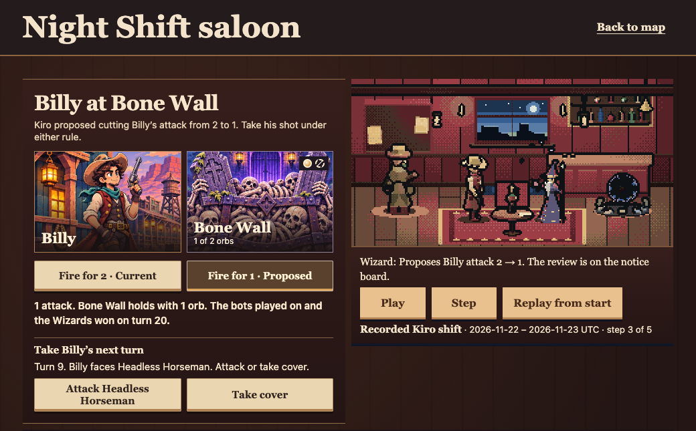
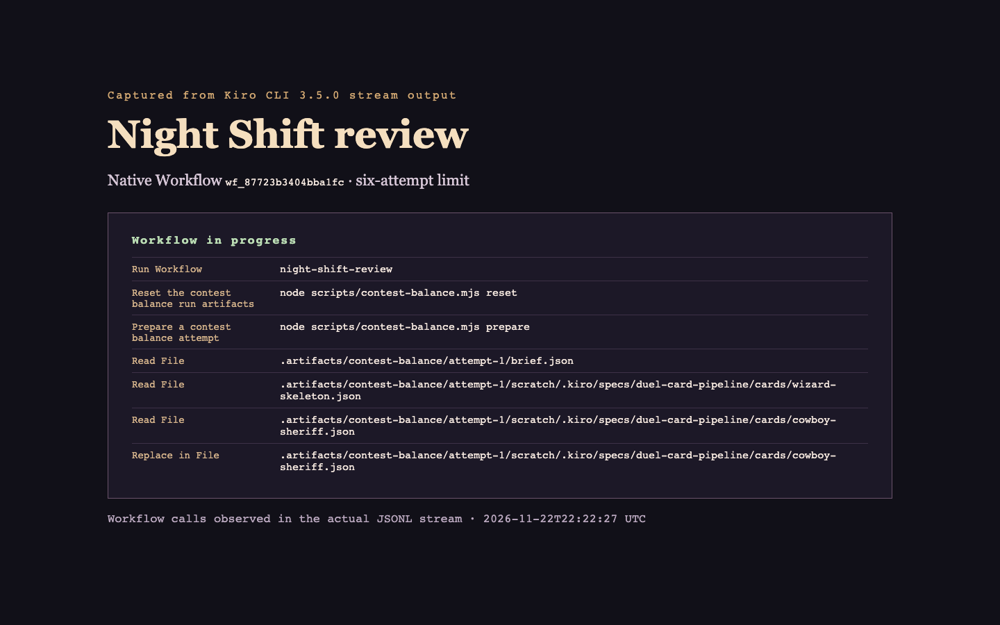
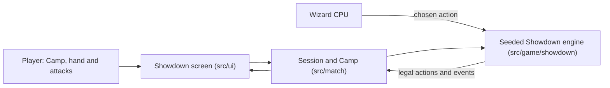

# Cowboys vs. Wizards: Showdown

Built with Kiro for Kiroween 2026 (**Costume Contest**), **Cowboys vs. Wizards: Showdown** lets strategy players and game designers playtest an AI-proposed card balance change before it hits their deck. In the **Night Shift Saloon**, Kiro CLI proposed cutting Billy’s attack from `2` to `1` under a SHA-locked Kiro spec (`NSB-1` / `NSB-2`) verified across **100,000 held-out bot duels** (`59.792% → 51.920%` Cowboy share). Fire at Bone Wall under both rules—and when the weaker Billy loses in the bots’ hands, take over turn nine against the Headless Horseman and save the deal by taking cover. Beyond the Saloon, play the full haunted-Western Trail, build a 16-card deck in Camp, or deal into **Boot Hill Poker**, a second live game powered by the shared [`packages/frontier-kit`](packages/frontier-kit/README.md) engine tools.

**[Play Showdown](https://alejandro-publius.github.io/cowboys-vs-wizards/)** · [Night Shift Saloon (`?saloon=review`)](https://alejandro-publius.github.io/cowboys-vs-wizards/?saloon=review) · [Kiro’s balance spec](.kiro/specs/night-shift-balance-contract/requirements.md) · [One-minute judge walkthrough](docs/JUDGE-GUIDE.md) · [Devpost packet](docs/submission/devpost-packet.md) · [Rules and cards](prototypes/showdown/RULEBOOK.md) · [Current build and review status](docs/PROJECT-STATUS.md#current-build)

| Playable AI Balance Courtroom (`?saloon=review`) | Recorded Native Kiro CLI Workflow (`wf_87723b3404bba1fc`) |
| --- | --- |
|  |  |
| Fire Billy’s printed `2`-attack shot vs. Kiro’s `1`-attack proposal, then play turn nine yourself | Isolated preparer/reviewer agents gated by `.kiro/specs/night-shift-balance-contract/requirements.md` |

## Play Showdown

| Where to start | What to try |
| --- | --- |
| [Night Shift Saloon](https://alejandro-publius.github.io/cowboys-vs-wizards/?saloon=review) | Fire Billy’s current two-attack shot and Kiro’s proposed one-attack shot at the same Bone Wall. The original rules resolve your shot in your browser. With the proposed Billy, take his next turn against Headless Horseman and change the ending. The notice board holds the [100,000-duel audit](docs/evidence/billy-seat-audit/README.md). |
| [Ride or Fight?](https://alejandro-publius.github.io/cowboys-vs-wizards/?outrider=case-e) | Pick the Outrider. Strike the Skeleton or ride past it and hit the Wizard Base. Restart the same turn and try the other choice. |
| [Camp and the Trail](https://alejandro-publius.github.io/cowboys-vs-wizards/) | Choose **Camp**, then **Boot Hill** for your first Trail duel. Camp also holds the deck builder, Wanted bounties and two-player mode. |
| [Replay Room](https://alejandro-publius.github.io/cowboys-vs-wizards/?room=replay) | Pick the Ranger’s target before seeing either outcome. Compare the two recorded lines and play the turn yourself. |
| [Even Fight](https://alejandro-publius.github.io/cowboys-vs-wizards/?even-fight=1) | Try cover against spells and a seven-orb Base for the second player. Practice also offers a [best of three](https://alejandro-publius.github.io/cowboys-vs-wizards/?even-fight=series) and [two players on one device](https://alejandro-publius.github.io/cowboys-vs-wizards/?even-fight=two). |
| [Boot Hill Poker](https://alejandro-publius.github.io/cowboys-vs-wizards/poker/) | Draw a five-card hand against the Wizard. The Saloon’s back table opens this second game. |
| [Lightweight board](https://alejandro-publius.github.io/cowboys-vs-wizards/graybox/) · [Reference game](https://alejandro-publius.github.io/cowboys-vs-wizards/showdown/) | The graybox opens directly into Camp. The reference page has a playable version of the rules. |

The illustrated game also runs at `/3d/`. The [deployment manifest](https://alejandro-publius.github.io/cowboys-vs-wizards/build.json) identifies the published commit and its HTML checksum. The [release record](docs/PROJECT-STATUS.md#current-build) links the source for the screenshot above.

## Local build

Use Node.js 22.18 or later and run these commands from the repository root.

```sh
npm ci
npm run build -- --diorama --contest
```

Open `dist/cowboys-vs-wizards-showdown-3d.html` in a browser to play the illustrated contest build offline. Use `?seed=N` for a reproducible deal. Fixed Boot Hill practice deals are available at `?practice=0` and `?practice=60`.

| Build or check | Command | Output |
| --- | --- | --- |
| Lightweight board | `npm run build` | `dist/cowboys-vs-wizards-board-duel.html` |
| Full Pages site, including Poker | `node scripts/stage-pages.mjs --commit "$(git rev-parse HEAD)"` | `dist/web/` |
| Play the staged site locally | `python3 -m http.server 8000 --directory dist/web` | Open `http://localhost:8000/` |
| Verify the staged routes and play them in Chrome | `node scripts/check-pages-tree.mjs --browser` | Checks the page identity, links, table controls and Saloon route |

## How it is made

**Kiro** sits at the center of both development and the playable Night Shift Saloon (`246+` tracked files under [`.kiro/`](.kiro/)):

| Kiro capability | Tracked in [`.kiro/`](.kiro/) | What it governs |
| --- | --- | --- |
| **Specs** | `44` spec folders (`660+` `SHALL` clauses, `10` written reviews) | Card catalog contracts, Outrider `G1–G7` gate, `NSB-1`/`NSB-2` balance thresholds, Saloon rooms |
| **Custom agents** | `20` profiles in [`.kiro/agents/`](.kiro/agents/) | Path-fenced `contest-balance-preparer` vs. read-only `contest-balance-reviewer`, `showdown-presenter`, `showdown-seat-auditor` |
| **Hooks** | `12` CLI hook configs across all `9` automatic triggers | `check-outrider-gate` on `PostFileSave` (`0 fresh, 10 stale` on drift), `PreToolUse` scope fences, doc-link checks, Stop gates |
| **Scoped steering** | `6` files in [`.kiro/steering/`](.kiro/steering/) (`inclusion: fileMatch` & `always`) | `rules-area.md` loaded for `src/game/**` reads and excluded on UI reads ([receipt](docs/evidence/showdown-scoped-steering.md)) |
| **Workflows, Power & Crew** | `7` Workflows, [`orb-duel-review`](.kiro/powers/orb-duel-review/) Power/MCP, [`Night Watch`](https://github.com/alejandro-publius/cowboys-vs-wizards-night-watch) Crew app | Native balance/audit loops, seat-private MCP duel play, and scheduled 2,000-duel commit patrols |

- **Kiro** implemented the Showdown gameplay briefs, the 29-card catalog, Camp/saves, property suites, Power 1.3.0, and the recorded balance, rules, and release workflows. See [Built with Kiro](#built-with-kiro).
- **Fable (Claude Code)** designed mechanics, progression, and engine contracts ([docs/design](docs/design/README.md)) and approves card/rule changes with Alex.
- **Codex** maintains the integration queue, reviews PRs against the rules contract, and verifies staged Pages builds in headless Chrome.

## How the haunted costume does a job

Every spooky Western element in the Costume Contest interface carries a concrete gameplay or audit function:

| Haunted interface element | Functional UX job |
| --- | --- |
| **Night Shift Saloon card table** | Turns a raw AI balance diff (`Billy attack 2 → 1`) into a playable two-shot courtroom where players prove counterplay survives |
| **Glowing life orbs on troops & Bases** | Instant integer health & overflow math across desktop and `375px` phone screens without tiny-font arithmetic |
| **Inspectable faction graveyards** | Shows the exact Undead card `Raise` will return and clears private hands behind a pass curtain in two-player hotseat |
| **Bone Wall (`Guard`) & Outrider (`Ride`)** | Spatial silhouettes and target-forecast banners communicate blocking vs. riding past before a click commits |
| **Sheriff’s Ledger & notice board** | Surfaces SHA-256 build digests, 100,000-duel held-out seat shares, and stale/fresh Outrider gate status in-world |

## Verify

Use `npm test` for the repository suite. The Camp and keyboard checks below take the lightweight board built with `npm run build`. The Pages check takes the complete staged site.

| What you need | Command |
| --- | --- |
| Play opens the Camp; Boot Hill won with clicks; seat privacy; every retired lane address opens Showdown | `node scripts/browser-showdown-check.mjs dist/cowboys-vs-wizards-board-duel.html` |
| Camp modes: rivals, Wanted, packs, deck builder and side deck, best of three, two players, save code, Start over | `node scripts/browser-showdown-modes-check.mjs dist/cowboys-vs-wizards-board-duel.html` |
| Trail duels paid and kept after reload; lane keepsakes shown, not carried | `node scripts/browser-showdown-trail-check.mjs dist/cowboys-vs-wizards-board-duel.html` |
| Keyboard-only and mouse play | `node scripts/browser-showdown-keyboard-check.mjs dist/cowboys-vs-wizards-board-duel.html` |
| Combat cues | `node scripts/browser-showdown-cues-check.mjs dist/cowboys-vs-wizards-board-duel.html` |
| Showdown rules | `node --test prototypes/showdown/rules.test.js prototypes/showdown/contract.test.js tests/game/showdown-presenter.test.js` |
| Tests as run on every pull request | `npm test` |
| The staged Pages site, as CI plays it in Chrome | `node scripts/stage-pages.mjs --commit <sha>`, then `node scripts/check-pages-tree.mjs --commit <sha> --browser`. On Linux, set `CHROME` to the Chrome executable. |
| Which commit the live site is (after a Pages deploy) | `curl https://alejandro-publius.github.io/cowboys-vs-wizards/build.json`; CI compares it and the live `index.html` digest, also at `/3d/`, with the built release ([evidence](docs/evidence/kiro-build-identity.md)) |

The saved **showdown-practice-replay** Workflow replays Boot Hill deals `?practice=0` and `?practice=60` in headless Chrome. Run `node scripts/verify-duel.mjs --browser` to test the staged Showdown site and its `/3d/` compatibility route. See the [Kiro write-up](docs/kiro-brag-sheet.md) for specs, hooks, tests, and replay evidence.

## Architecture at a glance

The Showdown engine decides which moves are legal and what damage happens; the screen shows those decisions. This keeps every seeded deal reproducible.



[Architecture and source ownership](docs/ARCHITECTURE.md) · [Current verified state and next priorities](docs/PROJECT-STATUS.md) · [Index of all documents](docs/README.md)

## Built with Kiro

Kiro proposed a one-point change to Billy’s attack. On one recorded deal, that single point decides whether Billy clears a Bone Wall. In 100,000 bot duels on held-out seeds, Cowboy wins moved from 59.792% to 51.920% under the proposal. Billy still has 2 attack in the published game. [Play the recorded review](https://alejandro-publius.github.io/cowboys-vs-wizards/?saloon=review) · [Check the audit and seeds](docs/evidence/billy-seat-audit/README.md)

The same Saloon includes the rules desk, the Dusty Pete trial and a replay of 54 decisions from the Cautious Sheriff and Reckless Wizard match. [Reproduce the Saloon findings](docs/evidence/night-shift-repair/README.md)

A separate Python referee matched the game at all 5,086 played positions in 100 frozen duels. The audit also compared 274,273 possible moves. It classified all 6,775 differences, including 39 empty-board Hellfire cases whose design ruling is still open. [Referee results](docs/evidence/claude-referee-legal-branches.md)

[Follow the judge evidence trail](docs/JUDGE-GUIDE.md) · [Kiro usage and receipts](docs/kiro-brag-sheet.md) · [Actual build log](docs/kiro-build-log.md) · [Active closeout queue](docs/kiro-closeout-queue.md) · [Research/source register](docs/kiro-source-register.md)

### Night Shift balance run

Kiro CLI with Claude Opus 5.5 proposed each one-number change. A separate simulator measured each candidate with level-2 bots, with each deal played from both starting seats. The loop stopped on attempt 3 when both factions fell in the 45–55% band on both seed ranges. Billy’s change is a proposal for review.

| Attempt | Proposal | Cowboy wins, tuning | Cowboy wins, holdout | Gate |
| --- | --- | ---: | ---: | --- |
| 1 | Sheriff health 3 → 2 | 60.75% → 56.50% | 59.00% → 52.00% | Fail |
| 2 | Skeleton health 3 → 4 | 60.75% → 57.00% | 59.00% → 53.25% | Fail |
| 3 | Billy attack 2 → 1 | 60.75% → 50.25% | 59.00% → 51.00% | Pass |

[Recorded run and seeds](docs/evidence/kiro-contest-run.md) · [Native workflow screenshot](docs/evidence/kiro-night-shift-native.png) · [Observed Kiro usage](docs/KIRO_USAGE.md)

In a later native Kiro CLI workflow (`wf_3e26f2fcd93c25a1`) given no card choices, Kiro proposed six one-number edits, the reviewer rejected all six, and the six-attempt limit ended the loop with no live card changed. Attempt 4, Skeleton attack 1 → 2, met the 45–55% band on both seed sets (48.50% and 46.00% Cowboy wins), but the first player's tuning share rose from 58.75% to 60.00%, 1.25 points against the 1 allowed, so rule NSB-2 rejected it. Independently of those six, the fixed Billy attack 2 → 1 proposal from the original run passed on 25,000 fresh held-out seeds at 51.920% Cowboy wins (exit 0), against 59.792% for the current Billy (exit 2). [Six-attempt receipts, Billy audit and replay commands](docs/evidence/billy-seat-audit/README.md)

For ongoing balance review, the separate [Night Watch Kiro Crew app](https://github.com/alejandro-publius/cowboys-vs-wizards-night-watch) compares committed game revisions on matching CPU seeds, records changes and drafts issue reports. It is an optional local development tool, **not** part of the shipped browser game. [Crew run evidence](docs/evidence/kiro-night-watch.md).

## Card art library

The [Showdown art direction catalog](prototypes/showdown/ART-DIRECTION.md) has prompts for all 29 cards, a shared style guide, 18 environment and prop briefs, and 13 model sheets. The [Sheriff](assets/cards/sheriff-card.webp) and [Dragon](assets/cards/dragon-card.webp) paintings are the style references.

Regenerate it after editing the briefs in [`prototypes/showdown/art.js`](prototypes/showdown/art.js):

```sh
node prototypes/showdown/export-art.mjs
```

The [Showdown card spreadsheet](prototypes/showdown/cards.csv) uses the same visual direction. Regenerate it with `node prototypes/showdown/export-cards.mjs`.

## Code map

| Path | Owns |
| --- | --- |
| `src/game/showdown/` | Showdown rules, cards, screen contract, progress and save codes |
| `src/app.js` | Entry point: the Showdown title, Camp, deck builder and duel screens |
| `src/ui/showdown-*.js`, `src/ui/showdown.css` | Showdown screen, Camp, builder and cues |
| `src/match/showdown-*.js` | Showdown session, campaign and match flow |
| `prototypes/showdown/` | Rulebook, reference page, card spreadsheet and the [art direction](prototypes/showdown/ART-DIRECTION.md) |
| `.kiro/specs/duel-card-pipeline/cards/` | Card specs that the Showdown card table reads |
| `assets/` | Optimized Tripo models, card illustrations and media (source assets, kept) |
| `experiments/boot-hill-poker/`, `packages/frontier-kit/` | Poker rules and UI, and shared game tools |
| `scripts/`, `tests/` | Build, replay, simulation and verification |
| `.kiro/`, `docs/` | Workspace guidance, requirements, research and evidence |

Legacy headless utilities still support archived rules experiments and reading old profile keepsakes. The playable lane build is in Git history at `ea183ee29dbd`.

Contributing with an AI agent? Start with [AGENTS.md](AGENTS.md), then use the [task-specific file router](docs/AGENT-ROUTER.md) rather than scanning the whole repository. Work on one owned area in a separate worktree and run its affected check. The engine decides outcomes. The screen renders the events and their before and after values.

## Assets and attribution

The models and clips in `assets/` are kept as source assets for the Showdown 3D layer. Dragon and Mounted Billy have articulated Blender attack clips. Skeleton has its fitted Tripo mesh. Sheriff has the approved sourced Mixamo idle. See the [animation plan](docs/character-animation-plan.md) before adding clips or replacing an export.

The pinned Lucca Cerf references and their MIT license are in [docs/references/lucca-character-factory](docs/references/lucca-character-factory). The [build log](docs/kiro-build-log.md) attributes work by Kiro, Fable, Codex, Tripo and the user.

[Historical closeout deployment](docs/evidence/kiro-closeout-deployment.md) · [Published build manifest](https://alejandro-publius.github.io/cowboys-vs-wizards/build.json)
