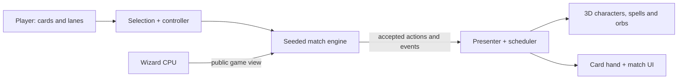

# Cowboys vs. Wizards

**A haunted-Western card duel: cowboys against wizards across three lanes.** It takes what long-running card games already proved (tribute summons, spells that answer a board, a graveyard, a deck you build) and keeps a duel short and easy to read.

## Status on November 18, 2026

The rules are being built first, in a plain "graybox" page: a flat board, text cards, life orbs and a clash log. The 3D models, animation and board go on top once the rules are locked, because motion is expensive to change. An earlier illustrated 3D duel is still [live in the browser](https://alejandro-publius.github.io/cowboys-vs-wizards/). It predates most of what is listed below, so this page shows no screenshots until the 3D layer matches the current rules.

No first-time human player has tested the current rules yet. Every balance figure in this repository comes from bot play. The [release line and scoreboard](docs/design/release-line.md) says what is in the game, what is waiting on a playtest, and what was cut.

## What is playable in the graybox

- **The duel.** Twelve-card decks, three lanes, one summon and one spell a turn, tributes for stronger troops, and both sides striking at once. Eighteen cards: twelve Cowboy, six Wizard.
- **A guided first duel** on a fixed, forgiving deal.
- **Wanted bounties.** Five notices each for the Lantern Wraith and the Graveyard Dragon. Clearing a boss earns its card and a showcase duel.
- **The Frontier cards.** Six Cowboy cards unlocked by wins, including riders that can change lanes, and two ready-made decks.
- **Rivals.** The Stargazer and the Imp, each built to make one deck rethink its plan.
- **Practice decisions.** Two short positions that open on the turn of a choice.
- **The Dragon Fire arc.** A boss fight that teaches a move, then a rival, the Bonewright, who answers it.
- **A deck builder** with drafts you can try before saving.

Every card is listed in the [card spreadsheet](docs/cards.csv), and the rules in the [rules sheet](docs/rules.csv).

## Play

Use Node.js 22.18 or later.

```sh
npm ci
npm run build
```

Open `dist/cowboys-vs-wizards-board-duel.html` in a desktop browser. Turns resolve immediately. Useful address endings:

| Ending | Opens |
| --- | --- |
| none | The main menu. **How to Play → Start guided duel** is the best first match. |
| `?mode=match&deck=starter&seed=690` | The guided deal without hints |
| `?mode=fire-arc` | The Dragon Fire arc |
| `?mode=practice-dynamiter`, `?mode=practice-tribute` | The two practice decisions |
| `?mode=ride-out` | The Ride Out lesson |

`npm run build -- --web` writes the self-contained graybox to `dist/web/index.html`.

`npm run build:art` builds the illustrated 3D duel and attack demo at the same path. That build needs WebGL 2 and includes the models and card art. `npm run build:art -- --web` writes it with content-hashed assets, and the Pages workflow publishes that build.

## How it is made

Three tools share the work, and each is credited for what it did.

- **Fable (Claude Code)** leads the design: mechanics, progression and engine contracts. Its briefs are in [docs/design](docs/design/README.md).
- **Kiro** builds those briefs, integrates them and runs the checks. See [Built with Kiro](#built-with-kiro).
- **Codex** coordinates, reviews and verifies in the browser.

## Verify

| What you need | Command |
| --- | --- |
| Illustrated title screen, settings, custom deck and pause/resume in Chrome | `node scripts/browser-menu-check.mjs http://127.0.0.1:PORT/?seed=0` (serve the illustrated web build) |
| Game, presenter and asset tests | `node scripts/verify-duel.mjs` |
| The same tests by their npm name, as run on every pull request | `npm test` |
| The same tests, a fresh illustrated build and an eight-step Chrome replay | `node scripts/verify-duel.mjs --browser` |
| Title menu, match start, WebGL 2 and one summon in WebKit, the Safari engine | `npx -y -p playwright-core@1.64.1 node scripts/browser-webkit-smoke.mjs http://127.0.0.1:PORT/` (serve `dist/web/` first; once: `npx -y playwright-core@1.64.1 install webkit`) |
| Attack demo geometry, grip and event order | `npm run check` |
| Which commit the live site is (after a Pages deploy) | `curl https://alejandro-publius.github.io/cowboys-vs-wizards/build.json`; CI compares it and the live `index.html` digest with the built release ([evidence](docs/evidence/kiro-build-identity.md)) |
| A seeded rules trace | `node scripts/play-match.mjs --seed 60` |

The Chrome check on macOS writes the receipt and screenshots to `.artifacts/kiro/replay/` when invoked through `verify-duel.mjs`. The saved **orb-duel-replay** Workflow runs the same command. See the [Kiro write-up](docs/kiro-brag-sheet.md) for the Spec, hooks, tests, review Power and MCP evidence.

## Architecture at a glance

The rules engine decides which moves are legal and what damage happens; the renderer shows those decisions at the correct moment. This keeps gameplay reproducible while animated attacks can overlap.



[Architecture and source ownership](docs/ARCHITECTURE.md) · [Current verified state and next priorities](docs/PROJECT-STATUS.md) · [Index of all documents](docs/README.md)

## Built with Kiro

Kiro's Requirements-First Orb Duel spec, custom agent, workspace steering, hooks, replay Workflow, and review Power/MCP are part of this repository—not a narrative added after the fact. The Kiro work is distinguished from Fable's match rules/CPU and Codex's integration and verification.

[Follow the judge evidence trail](docs/JUDGE-GUIDE.md) · [Kiro usage and receipts](docs/kiro-brag-sheet.md) · [Actual build log](docs/kiro-build-log.md) · [Active closeout queue](docs/kiro-closeout-queue.md) · [Research/source register](docs/kiro-source-register.md)

For ongoing balance review, the separate [Night Watch Kiro Crew app](https://github.com/alejandro-publius/cowboys-vs-wizards-night-watch) compares committed game revisions on matching CPU seeds, records changes and drafts issue reports. It is an optional local development tool, **not** part of the shipped browser game. [Crew run evidence](docs/evidence/kiro-night-watch.md).

## Code map

| Path | Owns |
| --- | --- |
| `src/game/` | Seeded rules, legal actions, public views and CPU |
| `src/match/` | Selection, controller, scheduler and event playback |
| `src/render/` | Three.js scene, rigs, orbs and combat cues |
| `src/ui/` | Illustrated hand, interactive overlay and menus |
| `src/graybox.js` | Graybox entry point and instant cues |
| `src/main.js` | Illustrated game boot, mode switching and frame loop |
| `assets/` | Optimized Tripo models, card illustrations and media |
| `scripts/`, `tests/` | Build, replay, simulation and verification |
| `.kiro/`, `docs/` | Workspace guidance, requirements, research and evidence |

Contributing with an AI agent? Start with [AGENTS.md](AGENTS.md), then use the [task-specific file router](docs/AGENT-ROUTER.md) rather than scanning the whole repository. Work on one owned area in a separate worktree and run its affected check. The engine decides outcomes. The presenter renders the events and their before and after values.

## Assets and attribution

Dragon and Mounted Billy play articulated Blender attack clips. Skeleton uses its fitted Tripo mesh with the duel’s summon, hit and defeat cues. Billy and Wizard use procedural rigs. Sheriff combines the approved sourced Mixamo idle with the existing procedural draw/fire sequence and runtime transition blending. See the [animation plan](docs/character-animation-plan.md) before adding clips or replacing an export.

The build includes Three.js (MIT) and Rapier (Apache-2.0) notices. The pinned Lucca Cerf references and their MIT license are in [docs/references/lucca-character-factory](docs/references/lucca-character-factory). The [build log](docs/kiro-build-log.md) attributes work by Kiro, Fable, Codex, Tripo and the user.

[Verified closeout deployment](docs/evidence/kiro-closeout-deployment.md)
