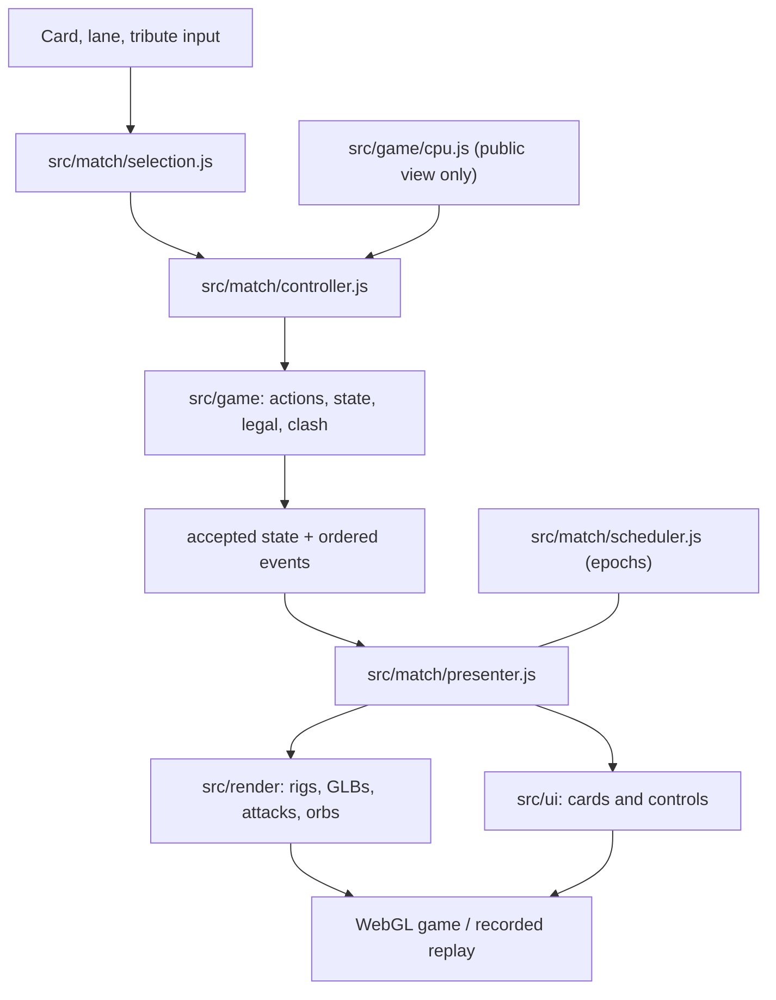

# Architecture — map, contracts and boundaries

[Back to game](../README.md) · [AI task router](AGENT-ROUTER.md)

The game is a JavaScript browser app built with Three.js, Rapier and esbuild. Its pure match engine determines gameplay; a controller and presenter turn accepted events into card/3D animation without recalculating damage.

## Contracts worth preserving

- **Engine authority:** `src/game/` has no DOM, network, renderer or asset dependencies. It owns card conservation, legal actions, phase changes, simultaneous combat and outcomes.
- **Public information:** `publicState(state, side)` hides opposing cards and both deck orders. The CPU and side-specific views use only their public snapshot.
- **Action identity:** `src/match/selection.js` constructs choices; the controller applies accepted actions once; the presenter consumes the resulting event ordering and before/after values.
- **Timed playback:** `src/match/scheduler.js` uses an epoch to cancel stale callbacks after restart or mode switch. Damage/orb updates appear at the event impact, not before.
- **Asset boundary:** `assets/models/` stores optimized GLBs and `assets/cards/` the approved illustrations. Keep source exports intact. A GLB measurement does not replace review in the actual browser.
- **Build and release:** `scripts/build.mjs` emits the single-file HTML or `dist/web/` with relative assets. `.github/workflows/pages.yml` verifies the game and publishes the web build.

## Smallest useful checks

| Change | Initial verification |
| --- | --- |
| Card rules, spells, CPU | `node --test tests/game/<closest>.test.js` |
| Controller, presenter, timing | `node --test tests/match/<closest>.test.js` |
| Animation rigs or models | `node --test tests/match/<closest>.test.js`; then browser frames |
| Gameplay integration | `node scripts/verify-duel.mjs` |
| Visual/browser integration | `node scripts/verify-duel.mjs --browser` on a machine with the supported Chrome setup |
| Build or deployment | `npm run build -- --web`; inspect GitHub Actions and browser artifact |

The `<closest>` placeholder is a filename selection, not a shell command to execute literally. [Exact file-by-task pointers](AGENT-ROUTER.md).

## Documentation boundaries

Keep this document as the technical map; [README](../README.md) is the public entry point; [Judge guide](JUDGE-GUIDE.md) is the five-click review route; [Project status](PROJECT-STATUS.md) is a **dated**, modest snapshot; `.kiro/specs/`, test cases and evidence notes contain deep specifics. Changes to a source-of-truth contract should update its focused test before claims of a completed release.
