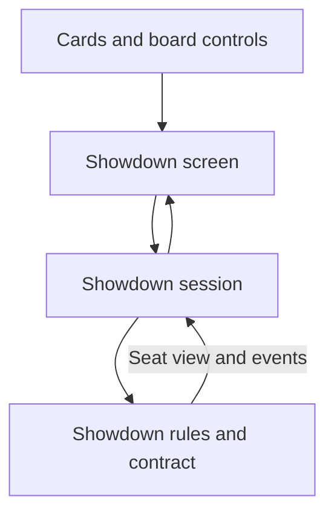

# Architecture — map, contracts and boundaries

[Back to game](../README.md) · [AI task router](AGENT-ROUTER.md)

Showdown is a JavaScript browser game bundled by esbuild. The rules engine owns the duel state and outcomes. The session applies legal actions and hands the seat-specific view and accepted events to the screen.

## Contracts worth preserving

- **Rules.** `src/game/showdown/` owns legal actions, card conservation, turn changes and duel outcomes. `viewFor` in its contract limits each seat to the information it may see.
- **Session and screen.** `src/match/showdown-session.js` applies actions. `src/ui/showdown-screen.js` draws the resulting board and `src/ui/showdown-cues.js` presents combat cues from the event stream.
- **Progress.** Campaign progress goes through `src/game/showdown/campaign-store.js`. The legacy profile reader supports keepsakes in the Camp.
- **Art.** `assets/` contains source models and illustrations for future presentation work. The [art catalog](../prototypes/showdown/ART-DIRECTION.md) covers all current cards.
- **Release.** `scripts/build-graybox.mjs` builds the offline page. `scripts/stage-pages.mjs` stages illustrated Showdown at `/` and `/3d/` and the lightweight Camp at `/graybox/` for GitHub Pages.

## Smallest useful checks

| Change | Initial verification |
| --- | --- |
| Card rules, spells, CPU | `node --test tests/game/<closest>.test.js` |
| Controller, presenter, timing | `node --test tests/match/<closest>.test.js` |
| Combat cues | `node scripts/browser-showdown-cues-check.mjs dist/cowboys-vs-wizards-board-duel.html` |
| Gameplay integration | `node scripts/verify-duel.mjs` |
| Visual/browser integration | `node scripts/verify-duel.mjs --browser` on a machine with the supported Chrome setup |
| Build or deployment | `npm run build -- --web`; inspect GitHub Actions and browser artifact |

The `<closest>` placeholder is a filename selection, not a shell command to execute literally. [Exact file-by-task pointers](AGENT-ROUTER.md).

## Documentation boundaries

Keep this document as the technical map; [README](../README.md) is the public entry point; [Judge guide](JUDGE-GUIDE.md) is the five-click review route; [Project status](PROJECT-STATUS.md) is a **dated**, modest snapshot; `.kiro/specs/`, test cases and evidence notes contain deep specifics. Changes to a source-of-truth contract should update its focused test before claims of a completed release.
