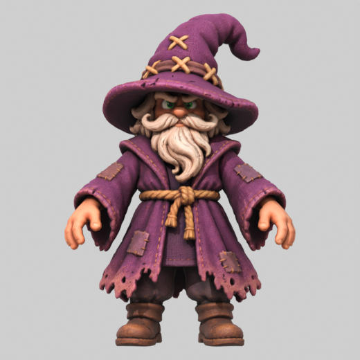
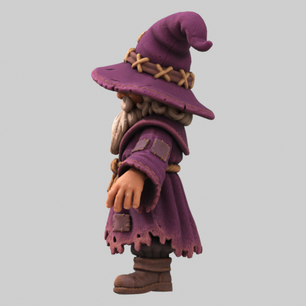
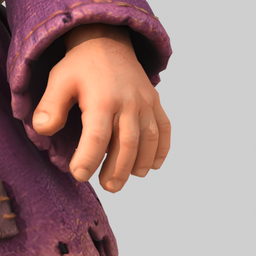
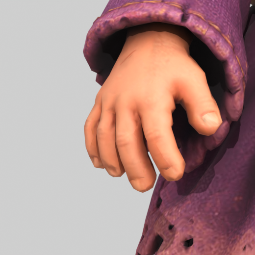

# Wizard animation readiness

Performed by Claude Fable 5.2 (Claude Code worker) on November 15, 2026, on branch
`fable/wizard-readiness` (from `37960ed`), with Blender 5.2.0 LTS run headless.
Read-only inspection of `assets/models/wizard.glb`. Nothing was rigged,
animated, exported or replaced. Every number below is output of
`scripts/blender/inspect-wizard.py`, except where a line says it comes from the
repository code or from the audit script.

**Verdict:** a wizard cast can proceed with the existing export. It needs no
new Tripo export of the body. The export is one static mesh with empty hands
and **no staff in it at all**; the staff seen in the demo is built in code. So
the staff has to stay a separate prop, which it already is. The limits are in
"Verdict and limits" below. This is a statement about the static mesh. It is not
evidence of a convincing grip, of clean deformation or of anything in the
browser.

## Commands and results

Run from the worktree root. `$OUT` is any scratch directory outside the
repository.

| Command | Result |
| --- | --- |
| `shasum -a 256 assets/models/wizard.glb` before | `5c0299527f3bc889402616cebb6d3fcf722202a9afdbe249335c5a02258a65d5` |
| `/Applications/Blender.app/Contents/MacOS/Blender -b --factory-startup --python scripts/blender/inspect-wizard.py -- assets/models/wizard.glb $OUT 64` | exit 0, four `RENDER_OK` lines, `$OUT/inspect.json` written |
| `shasum -a 256 assets/models/wizard.glb` after | identical |
| `git status --short assets/` after | no output |
| `node ../fable-asset-cli-test/scripts/audit-assets.mjs assets/models` (the audit script from the `fable/asset-cli-test` worktree, read-only) | `wizard.glb`: 2845456 bytes, 1 mesh, 27607 vertices, 44000 triangles, 0 skins, 0 joints, no clips; 8 files, 0 invalid |

The script was run three times. All three runs exited 0 and rendered with
Cycles on the CPU. Run 1 framed the hand close-ups on the sleeve instead of the
hand; run 2 fixed the framing; run 3 lowered the resolution to keep each PNG
under 300 KB and added the hat measurement. The counts and bounds were the same
in all three. The renders here are from run 3. The script refuses to write
inside the repository and saves no `.blend`.

## Measured facts

Blender imports glTF's Y-up as Z-up, so height is Blender Z and the character
faces Blender −Y. Units are the file's own; the file does not say they are metres.

| Fact | Value |
| --- | --- |
| Objects | 1, a mesh (`tripo_node_…`), no parent, location 0, rotation 0, scale 1 |
| Armatures, actions, objects with animation data | 0, 0, 0 |
| Vertex groups, shape keys, modifiers | 0, 0, none |
| Materials | 1 (`tripo_material_…`), on all faces; base colour, roughness/metal and normal textures, each 1280 × 1280 |
| Vertices | 27,607 as imported (same as the audit script); 21,978 after welding at 1e-6 |
| Faces | 43,998, all triangles. The file's JSON declares 44,000; the difference of 2 was not investigated |
| Bounds, min to max | X −0.3390 to 0.3395, Y −0.2136 to 0.2135, Z 0.0000 to 0.9784 |
| Dimensions | 0.6785 wide, 0.4271 deep, 0.9784 high |
| Lowest vertex | Z = 0.00000: the soles sit on the origin plane |
| Origin | on the floor plane, 0.0002 from the centre of the bounds in X and 0.00005 in Y |
| Connected parts after welding | **1.** Hat, beard, robe, hands and boots are one connected surface with 100% of the triangles |
| Open or non-manifold edges | 4 boundary edges, 2 edges shared by three or more faces, 0 wire edges |

**Staff:** there is none in this file. It is not a separate object, not a loose
part, not a separate material and not fused into the body. Both hands are empty.
Nothing needs to be cut off the mesh.

Hands and hat, in the frame `src/render/rig.js` uses (centred in X and depth,
feet at Y = 0, height = 1, +Z toward the viewer):

| Fact | +X side | −X side |
| --- | --- | --- |
| Widest point | (0.347, 0.340, 0.086) | (−0.347, 0.347, 0.090) |
| Lowest point beyond \|X\| = 0.26 (a fingertip) | (0.320, 0.290, 0.130) | (−0.319, 0.290, 0.128) |
| Sleeve and hand beyond \|X\| = 0.26 | Y 0.290 to 0.500, depth −0.032 to 0.166 | Y 0.290 to 0.501, depth −0.030 to 0.166 |
| Lowest hat vertex at \|X\| ≥ 0.22 | Y 0.672 | Y 0.681 |

Everything above Y = 0.66 (head, hat brim and hat tip) spans X −0.233 to 0.241
and depth −0.211 to 0.218. The two sides match to within 0.01, so the pose is
close to symmetric.

## Renders

Headless Cycles renders of the real asset, orthographic, 520 × 520, one sun and
a flat grey world. Front and side frame 1.0567 units; the hand close-ups frame
0.2544 units. What I say about appearance is my reading of these renders, not a
browser or in-game check.

| Front | Side, seen from +X |
| --- | --- |
|  |  |

| +X hand (the staff hand in `rig.js`) | −X hand |
| --- | --- |
|  |  |

My reading:

- The arms hang out and down and slightly forward, an A-pose rather than a
  T-pose. No staff or other prop is visible.
- Both hands are open and relaxed with the fingers half curled. Four fingers and
  a thumb are sculpted as distinct shapes, but neighbouring fingers look joined
  by shallow grooves rather than separated. Not measured.
- Wide bell sleeves end around the wrist and hang below it. The hat brim
  overhangs the shoulders, and the hat tip curls toward +X, the character's
  left, which is a usable left/right marker.

## What the existing procedural rig does

From `src/render/rig.js` and `src/render/scene.js` at `37960ed`:

- `rigActor` clones the GLB geometry, centres it, puts the lowest point at 0
  and scales the height to 1. `scene.js` then scales the wizard by 2.02. So one
  rig unit is 0.9784 file units and 2.02 scene units.
- The skeleton is 16 bones placed from a hard-coded table (`builds.wizard`),
  mirrored left to right. Skin weights are computed per vertex from its rest
  position with hard-coded thresholds, at most four influences.
- `closeWizardGrip` edits the rest geometry itself: it rotates the +X hand's
  finger vertices by up to 1.56 rad about a fixed pivot (X 0.308, Y 0.354).
- `attachStaff` builds the staff from Three.js primitives (a tube of radius
  0.016 along a six-point curve from −0.371 to 0.393, a wrap of radius 0.019,
  five bands and an octahedron jewel), turns it 90° about X and parents it to
  the +X wrist bone at `wizardStaffGrip − wrist` = (0.005, −0.050, 0.036).
- The cast is nine keyed hand targets (`staffKeys`, 0 to 3.69 s) solved by
  two-bone IK, with the hand target between Y 0.430 and 0.559.

Distance from each hard-coded point to the real rest surface, in rig units:

| Point in `rig.js` | +X side | −X side |
| --- | --- | --- |
| shoulder (0.126, 0.546, −0.012) | 0.050 inside | 0.051 inside |
| elbow (0.219, 0.452, 0.015) | 0.038 inside | 0.038 inside |
| wrist (0.278, 0.397, 0.072) | 0.016 inside | 0.017 inside |
| palm (0.301, 0.356, 0.109) | 0.004 outside | 0.003 outside |
| `wizardStaffGrip` (0.283, 0.347, 0.108) | 0.018 outside | 0.018 outside |

The joints lie inside the mesh and the grip point lies 0.018 off the rest
surface, about one staff radius. That shows the numbers were fitted to this
mesh. It does not show that the hand grips the staff convincingly: the fingers
are only bent afterwards in code, and no posed frame was inspected here.

## Lucca reference versus this export

Sections read: `character-rig.md` 1 to 5 and 4b, `character-engine.md` 1. The
upstream scripts they name are private and absent, so none of their gates ran.

| Reference asks for | This export |
| --- | --- |
| Landmarks measured on the rest mesh from front and side sheets, never guessed (rig 2) | Front and side orthographic renders exist now. Joint landmarks are still the hard-coded `rig.js` table; only their distance to the surface was measured |
| Left/right checked against an asymmetric marker (rig 2) | The hat tip curls to +X (my reading) |
| Model gates before rigging: arm reach overhead, corridor past the head, finger wrap, cuff (rig 3) | Not run. Measured context: the hat reaches \|X\| 0.233 to 0.241 with its lowest outer vertices at Y 0.672 to 0.681, and the sleeve cuff surrounds the wrist (my reading) |
| Every rigid accessory is a separate object on its own bone; prop bones hold no skin (rig 4) | 1 object, 1 connected part. The staff is absent, so a separate staff satisfies this. Hat, beard and sleeves cannot be separate objects without cutting the mesh |
| A welded mass that bends, such as a beard, becomes its own island (rig 4) | The beard is welded into the single surface |
| A hand with separate fingers gets finger joints and a fist test; a held prop gets its own bone so it can be dropped (rig 4b) | Fingers look joined (my reading); no bones exist |
| `open_edges` is 0 in the game-ready report (rig 1) | 4 boundary edges and 2 non-manifold edges |
| Export: clean skeleton, at most 4 influences, each prop its own mesh on one bone, named clips, height read from the vertices (engine 1) | 0 skins, 0 joints, 0 clips. Height from the vertices is 0.9784 |

## Verdict and limits

The cast can proceed on this export with a separate staff, by either route:

1. **Keep the procedural rig.** This is what the demo already does. Limits: no
   exported skeleton or clip exists; every weight, landmark and grip number is
   tied to this exact mesh, so any new export invalidates them; the finger curl
   is a fixed edit of the rest shape.
2. **Rig this mesh in Blender and save a new file**, leaving `wizard.glb`
   untouched, with the staff as a separate object on its own bone. Limits: the
   single welded surface means hat, beard, sleeves and robe hem can only move by
   skin weights; if the fingers are joined as they look, they cannot get
   individual bones, so the grip is a stylised whole-hand curl; a raised hand has to stay clear of the
   hat; the reference targets Blender 4.5 and its scripts are absent, so the
   rigging steps would be written here.

A new Tripo export is needed only if the owner wants one of these:

- fingers that close one by one: a new body export in the same A-pose with
  empty hands and clearly separated fingers;
- hat, beard or sleeves that move as their own parts: an export with those as
  separate parts;
- a modelled staff instead of the procedural one: a staff alone, straight, as
  one object in its own file. The body export does not change.

Do not request a body export with the staff in the hand: the reference wants
the prop as a separate object, and this export already has empty hands.

## Needed from the owner

1. Route 1 or route 2 for the first cast.
2. Staff: keep the procedural staff, or supply a staff model as above.
3. Hand: accept a stylised whole-hand curl, or request separated fingers.
4. What one scene unit is in metres. The file is 0.9784 units high and the
   scene scales the wizard to 2.02. The plan's millimetre targets need this.

## Not done

No rig, weights, clip, export, browser load or build. No posed frame was
inspected, so grip, sleeve and beard deformation and floor contact in motion
are unverified. Finger separation and the reference's model gates were not
measured. Billy and the other models were not inspected.
