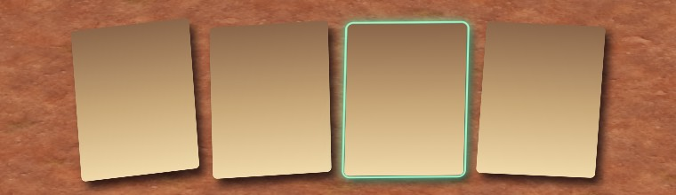
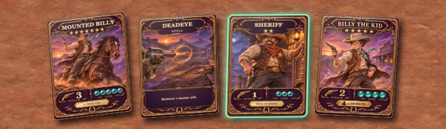
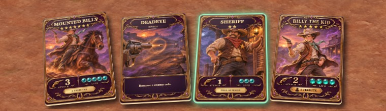

# WebKit blank hand cards (#41): diagnosis, fix and pixel check

Work by Kiro CLI (assigned by Codex), 2026-11-16 Pacific, issue #43. The #41 harness (`scripts/browser-webkit-smoke.mjs`) was read from `71a3580` and run unchanged from an ignored copy; its committed receipt is not touched.

**Engine: Playwright WebKit 27.2 (build v2370, `playwright-core` 1.64.1) and Playwright Chromium 156, both headless on a desktop Mac. This is not real Safari and not an iPhone.** Whether Safari shows the defect is still unknown.

## Reproduction

Baseline build: `main` `c65f49e`, `npm run build -- --web`, `dist/web/index.html` SHA-256 `2350e260…d59af` (same hash as #41's receipt). Served with `python3 -m http.server`.

`npx -y -p playwright-core@1.64.1 node <#41 smoke script> http://127.0.0.1:8131/` gave 7 of 7 steps "seen", and the screenshot shows four blank tan cards. #41 reproduced; the smoke steps pass over the defect.

## Diagnosis

Each card is `.card-body` (`transform-style: preserve-3d`) holding a front face at `translateZ(+4px)`, a reverse at `rotateY(180deg) translateZ(4px)` and seven edge slices at `translateZ(-3px…+3px)` (`src/ui/card-art.js`). Computed styles in WebKit are correct (matrix3d values, `preserve-3d`, `backface-visibility: hidden`). Experiments injected into the page, each screenshotted:

| Page change | Hand shows |
| --- | --- |
| none | tan (last slice on top) |
| slices hidden | card backs (reverse on top) |
| slices and reverse hidden | correct fronts |
| `-webkit-backface-visibility`, `overflow: visible`, `will-change`, `preserve-3d` on the button, +1px Z on the faces | no change |
| front moved last in the DOM | fronts, but in the art viewer's flipped state a mirrored front covers the back |

Reading: in this WebKit build the layers are painted in stacking order, not sorted by depth, and `backface-visibility: hidden` does not hide the back-facing layers. Chromium sorts by depth and culls, so it is unaffected. This is an inference from these experiments, not a WebKit bug report.

## Fix (`src/ui/match.css` only, 8 lines)

- `z-index` slice 0, reverse 1, front 2: gives WebKit the paint order. Chromium's depth sorting still decides there.
- `.card-face {transition: visibility .23s}` plus, in the art viewer only, `.is-flipped .front-face` and `:not(.is-flipped) .card-reverse` get `visibility: hidden`. Visibility interpolation keeps both sides drawn through the flip, so no pop in Chrome; the flip, hover lift, selection and edge slices are otherwise unchanged. `src/ui/cards.js` and `card-art.js` are untouched.

## Regression check: `scripts/browser-card-face-check.mjs`

Run: `npx -y -p playwright-core@1.64.1 node scripts/browser-card-face-check.mjs http://127.0.0.1:8123/ [--browser webkit|chromium] [--out-dir PATH]`

It screenshots the page and compares the middle 40% of each card's layout box (overall mean color plus a 2x2 grid of means, averaged in JS because WebKit canvas downscaling to 1 to 2 pixels samples points) against three references: the card's own art from its computed background, the card back, and the tan edge-slice color. The face passes only when its art is the nearest reference by a 10% margin. States: opening hand, hovered card, selected card, hand after a Sheriff summon, art viewer front, art viewer flipped (expects the back). A browser that will not start exits 2 (blocker, not a pass); any state failing exits 1.

Distances (lower is closer; expected-face distance vs next nearest), `distance` columns from `result.json`:

| Run | Build `index.html` SHA-256 | Result | Notes |
| --- | --- | --- | --- |
| WebKit 27.2, baseline `c65f49e` | `2350e260…d59af` | **0 of 6, exit 1** | art 228 to 340 away, tan slice 20 to 34 away: tan |
| WebKit 27.2, fixed | `f9f0d4f4…f121a` | **6 of 6, exit 0** | art 11 to 22, nearest other 53 to 151; flipped back 17 vs art 44 |
| Chromium 156, baseline | `2350e260…d59af` | 6 of 6, exit 0 | unpatched Chrome was never affected |
| Chromium 156, fixed | `f9f0d4f4…f121a` | 6 of 6, exit 0 | art 10 to 23, nearest other 52 to 143 |

The check therefore fails on the unpatched WebKit build and passes on the fixed WebKit and Chromium builds. The fixed build was built from `c65f49e` plus the `match.css` change in the commit that carries this note; the exact commit is in the final report.

| WebKit before | WebKit after | Chromium after |
| --- | --- | --- |
|  |  |  |

Full-size screenshots and `result.json` per run are in `.artifacts/kiro-webkit/` (ignored). I also looked at the WebKit art-viewer front and flipped screenshots after the fix: the Sheriff front, then the card back, with the edge visible.

## Not covered

- Real Safari on a Mac or iPhone, touch input, phone-sized viewports (ledger K07 stays open).
- The in-flight draw and summon flight cards (`.card-flight`) were not examined for the same layering; the post-summon hand was checked.
- The `#40` and `#35` changes to the hand were not present; merge order may need a re-run of the check.
- The pixel thresholds were tuned on this seed and these 8 card arts, not on a wider sample.
- The mid-flip frames in WebKit show both sides drawn for 0.23 s (not measured frame by frame).
