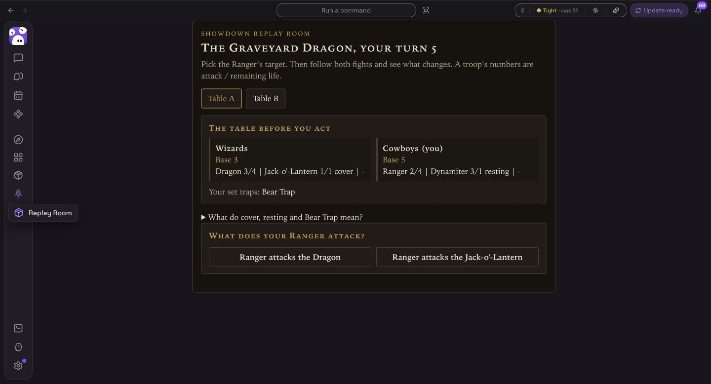

# Showdown Replay Room

November 20, 2026. The Crew sidebar opens a decision a player can try. It uses the same DOM panel and replay data as Camp on the browser build. The decision does not depend on a running model.



## Play and verify

In the browser choose Play → Camp → Experiment → Replay Room or add `?room=replay` to the build URL. In Crew, install the local app and enable Showdown Replay Room in the dashboard. The running gateway was 0.12.2 and the CLI was 0.13.0. Crew stored the per-app approval with empty API and event grants. The panel has no backend. Its game link opens the original decision on the live Showdown site.

```sh
npm ci
node scripts/build-graybox.mjs
node --test apps/replay-room/test/*.test.mjs .kiro/powers/orb-duel-review/test/*.test.mjs
node apps/replay-room/build.mjs --check
kirocrew app install "$PWD/apps/replay-room"
```

Four Kiro CLI workers produced the lesson projection, panel, Power extension and first judge draft in separate Git worktrees. The coordinator integrated the two entry points and verified them. A fifth Kiro worker implemented the experimental CLI profile after Fable’s design review. A separate Kiro worker independently tested denying the reveal.

| Check | Observed |
| --- | --- |
| Rules and repository checks | 612 tests passed, followed by structural checks on the two animated GLBs. |
| Room and Power | 42 tests passed. The fixture check replays the original engine and compares both branches. Poisoning a fixture with hidden opponent fields did not surface those fields in the projection. |
| Desktop and narrow browser | Headless Chrome opened the offline game at 1280 and 390 pixels. All four picks in each viewport matched the recorded winners and turn numbers. End and Home reached the fourth and first snapshots. The room left the save empty, restored focus, and handed Table B to the playable turn. The Ranger attack removed the Jack on that board. |
| Installed Power | A native CLI session in an empty directory called the installed 1.6.0 Power four times. Neither position response included outcomes. Each reveal returned both winners and the chosen line’s four public end-of-turn boards. |
| Human observations | The author played the game. A first-time comparison between the room and the experimental CLI profile is still open. |

## Design review

Fable 5.2 rated the proposed chat coach **5/10**. A newcomer can access the panel in their browser, whereas the CLI experiment requires Kiro. Both tables use the same opposing troops and the recorded winning choice reverses. Picking the opposite answer on table two therefore cannot demonstrate learning. Several board facts and the hidden draws differ between the deals.

Fable recommended shipping the definitions of cover, resting and Bear Trap directly in the panel and freezing the chat profile as an experiment. A dedicated native test approved the public position, locked Dragon and rejected the reveal. Kiro’s first permission request showed the Power name. The target was visible in a separate tool-call event. Denial withheld both winners and both end turns. The evidence supports refusal; it does not establish that a player can read their chosen target in the native permission prompt.

## Recent Kiro releases and prior winners

The September 30 release introduced reusable multi-agent Workflows. This game has recorded Workflow runs for Boot Hill practice and release review. The November 2 IDE release added a run tree and individual step transcripts, which a presenter can use to show which worker rejected a changed build. November 19 brought conductor mode into standard Crew 0.13.0. The verified Replay Room app ran on gateway 0.12.2. CLI worker runs and Crew Conductor runs have different evidence. [Workflows announcement](https://kiro.dev/blog/introducing-workflows/) · [IDE 1.4.86](https://kiro.dev/changelog/ide/1-4-86/) · [Crew 0.13.0](https://kiro.dev/changelog/crew/0-13/)

The 2025 winner InteractionKit built reusable interaction components and demo apps. Our comparable demonstration is one real decision running in two places, using identical engine-backed data. Historical winner descriptions cannot establish that any approach here is unprecedented. [InteractionKit](https://devpost.com/software/kiro-interactionkit) · [Kiro Guides](https://kiro.dev/docs/guides/) · [Kiro Documentation](https://kiro.dev/docs/)

## First-time playtest

Give a new participant the blind entry before sharing any outcomes. Ask, “What do you think the Ranger’s attack will change, and why?” Record their words before they click. Then ask them to point to the first snapshot that confirms or contradicts their prediction. For a comparison, randomize starting table and panel versus CLI with at least ten first-time participants, record assistance needed and judge the explanation blind. Real people must provide these observations.
