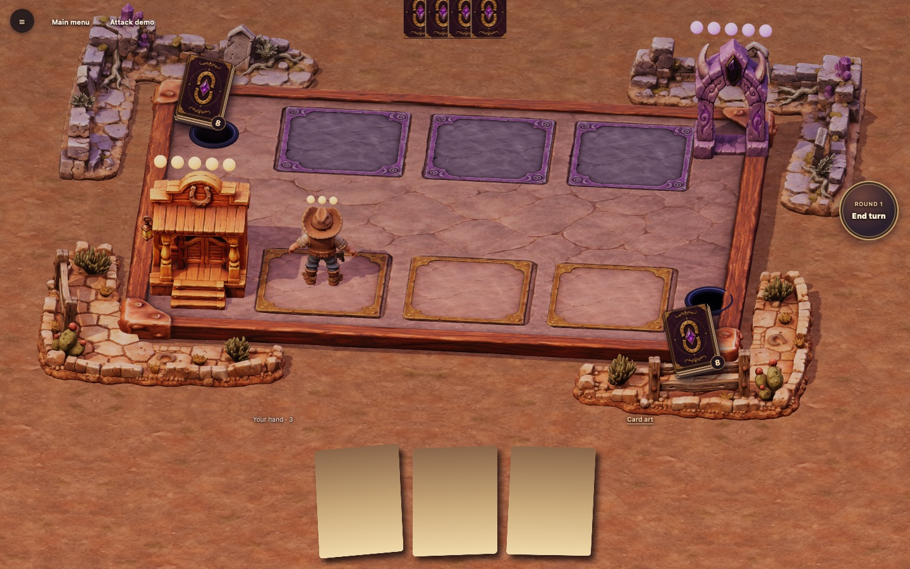
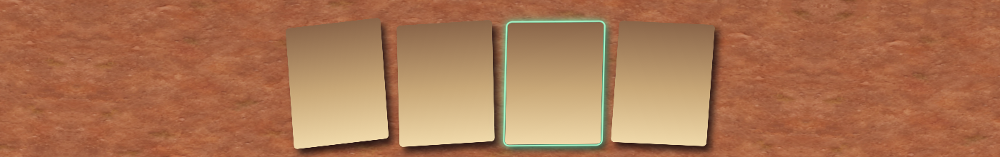
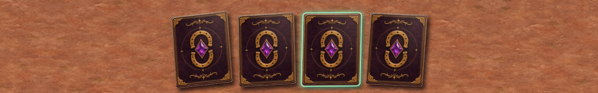

# WebKit smoke check: the game starts and plays, but hand cards are blank

Work by Fable (Claude Fable 5.2, in a collaborator's Claude Code session), 2026-11-16 Pacific, on branch `rachel/webkit-smoke` for issue #30. Not Kiro or Codex work. Nothing under `src/` was changed.

**This is Playwright's WebKit build on a desktop Mac. It is not Safari, and it is not an iPhone.** Ledger item K07 (real phone and Safari) stays open; this run only narrows what to look for there.

## Result

All seven scripted steps were seen. **The screenshots also show a defect the steps do not test for: every card in the Cowboy hand is drawn as a blank tan rectangle, with no illustration, name or numbers.** In Chrome the same build shows the illustrated card faces. A player in this engine can still select and summon, but cannot read their cards.

| Step | Result | What the page showed |
| --- | --- | --- |
| 1. Title menu appears | seen | Play button visible |
| 2. Match starts with `?mode=match&deck=starter&seed=0` | seen | status `accepting_input`, 4 cards in hand |
| 3. WebGL 2 context, or the fallback | seen: **WebGL 2**, not the fallback | `WebGL 2.0`, canvas 1440×900; the 3D board, Bases and orbs are drawn |
| 4. Card chosen | seen | `cowboy-sheriff-5` selected |
| 5. Lane picked | seen | "Your lane 1: empty" picked; Confirm enabled |
| 6. Troop summoned | seen | lanes read `Sheriff 3/3 \| Empty \| Empty`; the Sheriff model stands on the tile |
| 7. No console errors | seen | 0 console errors, 0 uncaught errors |

| Title menu | After the summon |
| --- | --- |
|  |  |

## The blank hand cards

| As rendered | With the card's edge layers hidden (experiment) |
| --- | --- |
|  |  |

What was observed, and one experiment:

- The card face's artwork is loaded: the front face's computed background is the card's image URL, and no request failed.
- Each card is built from stacked layers placed in 3D: a front face, a reverse face turned 180 degrees, and seven thin "slice" layers that give the card its edge (`.card-body` with `transform-style: preserve-3d` in `src/ui/match.css`).
- In this engine the layers appear to be painted in document order instead of by depth. The last slice, a plain tan gradient, covers the face.
- Hiding the slices in the page (a one-off style injected for the experiment, not a change to the game) revealed the card **backs**, not the fronts. So the reverse face is also painted over the front, which fits the same reading: depth order and back-face hiding are not taking effect.

This is a reading of two screenshots, not a diagnosis. No fix was attempted; the issue puts `src/` out of bounds. **Whether real Safari does the same is not known.** Opening the game in Safari on a Mac and looking at the hand would settle it in a minute, and belongs with issue #21.

## Run conditions

| | |
| --- | --- |
| Command | `node scripts/browser-webkit-smoke.mjs http://127.0.0.1:8123/` |
| Build served | `npm run build -- --web`, then `python3 -m http.server 8123 -d dist/web`; `dist/web/index.html` SHA-256 `2350e260ff7bb5c800098d1f082862f53b448a1825ce2b5258a285d8b48d59af` |
| Commit | `c65f49e` (`main`), plus this branch's script |
| Engine | Playwright WebKit 27.2 (build v2370), headless, from `playwright-core` 1.64.1 |
| User agent | `Mozilla/5.0 (Macintosh; Intel Mac OS X 10_15_7) AppleWebKit/605.1.15 (KHTML, like Gecko) Version/27.2 Safari/605.1.15` |
| Operating system | macOS 26.6.2 (Darwin 25.6.0, arm64), Apple M3 |
| Viewport | 1440×900 |
| Date | 2026-11-17T05:27:59Z (November 16, 9:27 p.m. Pacific) |
| Duration | about 9 s |
| Raw result | [`webkit-smoke/result.json`](webkit-smoke/result.json), copied from the ignored output folder `.artifacts/webkit-smoke/` |

The script writes a screenshot per step and `result.json` to `.artifacts/webkit-smoke/`, which git ignores. The files in `docs/evidence/webkit-smoke/` are copies from this one run; the two board screenshots were converted to JPEG to keep them small. The two hand close-ups came from a separate throwaway script against the same served build and are not produced by the smoke check.

## What this check does not cover

- Safari itself, on a Mac or an iPhone, and any touch input.
- A phone-sized viewport.
- Whether the cards are readable. The steps passed while the cards were blank, so a green result from this script does not mean the game looks right.
- Anything past the first summon: no Wizard reply, clash, spell or result was played.
- Sound, performance and load time.
