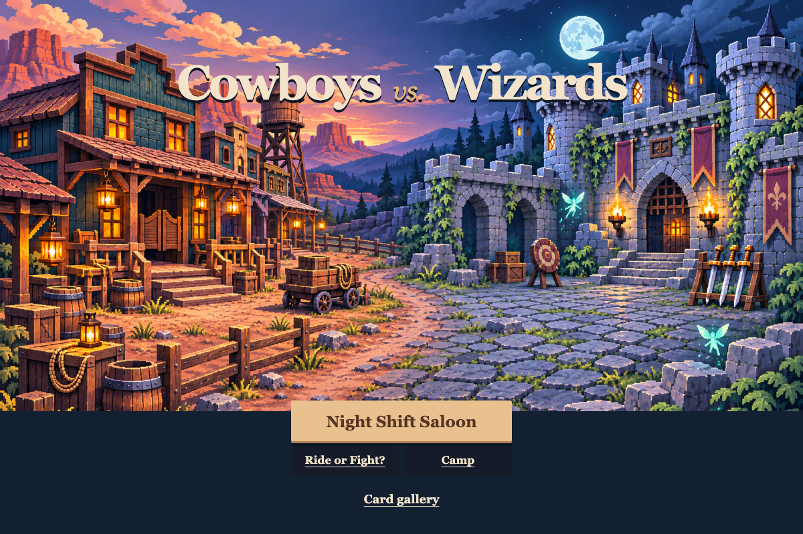
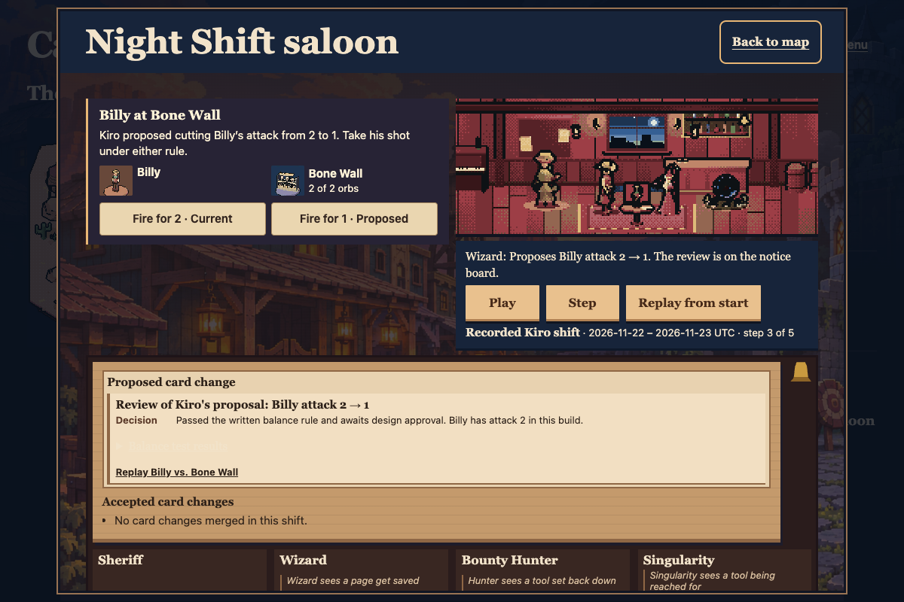
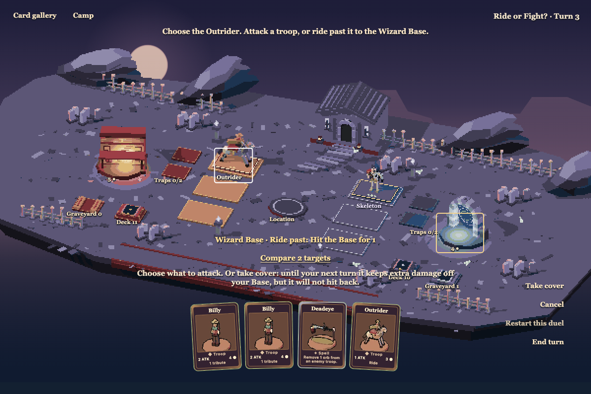
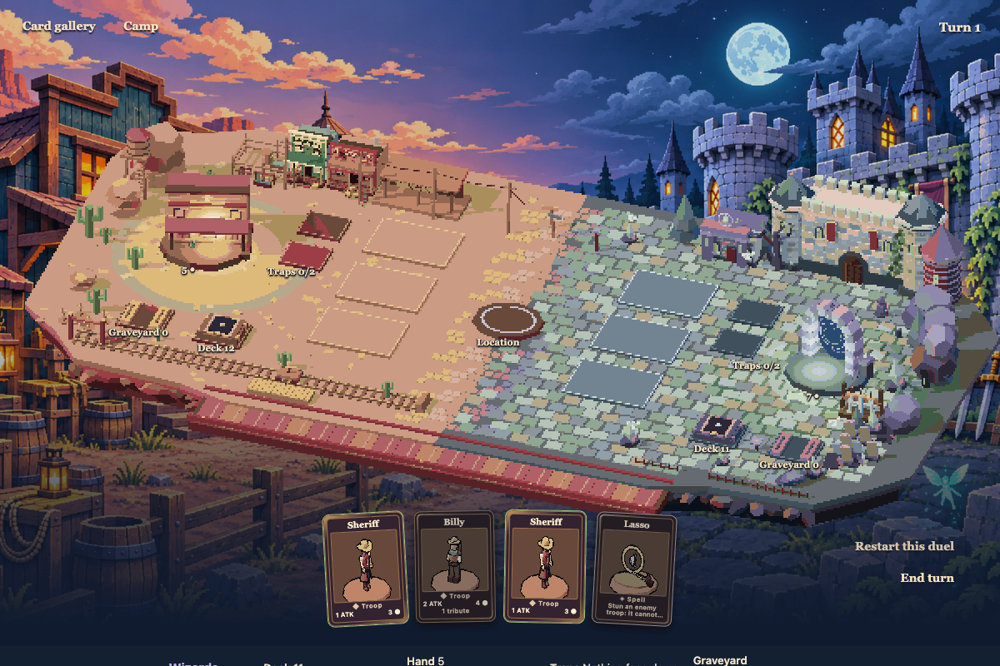
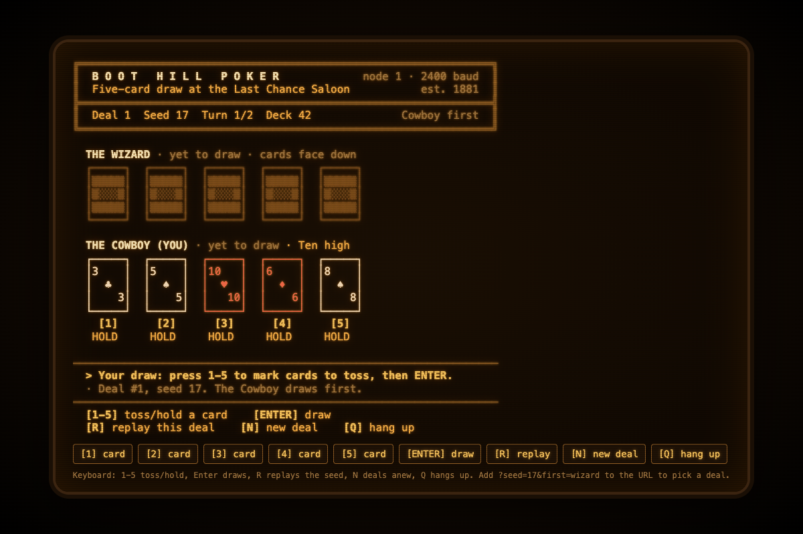

# Devpost Form Answers, Pre-Existing Work Disclosure & 3:2 Gallery Pack

Companion to [`devpost-packet.md`](devpost-packet.md) closing the official rules gaps documented in [`rules-check.md`](rules-check.md) (Issue [#38](https://github.com/alejandro-publius/cowboys-vs-wizards/issues/38)):
1. **Five `1200x800` (`3:2`) Devpost gallery screenshots** captured from the staged Pages build (`93db9f3e2f3970ec8b391650199027eac1d252db`) with SHA-256 provenance ([`manifest.json`](../evidence/devpost-gallery/manifest.json)).
2. **Direct answers to every sub-question across the 8 required Kiroween Kiro topics**—with `[OWNER]` placeholders wherever the rules require personal builder reflection rather than AI-authored prose.
3. **Pre-existing work & third-party asset disclosure paragraph** required by the official rules.
4. **Video third-party trademark check** on the current `1:20` narration ([`judge-demo-narration.md`](judge-demo-narration.md)).

---

## 1. Five `1200x800` (`3:2`) Devpost Gallery Images

Upload these five files from [`docs/evidence/devpost-gallery/`](../evidence/devpost-gallery/) directly into the Devpost Image Gallery (Judges *"may choose to judge based solely on the text description, images, and video"*):

| # | Image (`1200x800`, `3:2`) | Copy-paste Devpost gallery caption |
| --- | --- | --- |
| 1 |  | **Showdown Title (`/`):** Zero-login browser entry into the Night Shift Saloon balance courtroom, the *Ride or Fight?* tactical lesson, Camp deck-building, and 29-card gallery. |
| 2 |  | **Night Shift Saloon (`/?saloon=review`):** Test Kiro Workflow `wf_87723b3404bba1fc`’s `Billy 2 → 1` attack proposal on turn 7 (`59.792% → 51.920%` across 100,000 held-out duels) before any nerf touches the live deck. |
| 3 |  | **3D Bone Fence (`/?outrider=case-e`):** On-board combat forecast compares striking the Skeleton vs riding past to deal 1 Base damage, backed by Kiro’s `PostFileSave` Outrider replay gate. |
| 4 |  | **Showdown Even Fight (`/?even-fight=1`):** Split frontier/castle 3D arena with 3-slot tactical lanes, integer life orbs, trap slots, inspectable graveyards, and 16-card Cowboy deck play. |
| 5 |  | **Boot Hill Poker (`/poker/`):** Live second game sharing `packages/frontier-kit`’s deterministic seeded RNG and paired-cohort balance audit kit with Showdown. |

---

## 2. Official 8-Topic Kiro Write-Up Sub-Questions (Copy-Paste Answers)

### Topic 1: Kiro Apps
- **Which Kiro apps did you use?** Kiro IDE, Kiro CLI (`3.5.0`), and Kiro Crew (Kiro Web was not used).
- **How did they differ when used together?** Each surface handled a different stage of development: **Kiro IDE** was best for interactive Requirements-First spec authoring and structured bugfix specs (such as the [Bear Trap log bugfix spec](../../.kiro/specs/showdown-bear-trap-log/bugfix.md)); **Kiro CLI** ran unattended workers in isolated git worktrees, enforced `PreToolUse` / `PostFileSave` / `Stop` hooks, and executed multi-step native Workflows (`wf_87723b3404bba1fc`, `wf_3e26f2fcd93c25a1`, `wf_27f8bf0bb063c889`); and **Kiro Crew** ran scheduled commit-to-commit balance patrols ([`Night Watch`](../evidence/kiro-night-watch.md)) and retained rival memory across context resets ([`Overnight Rival`](../evidence/showdown-rival-checkin.md)).

### Topic 2: Custom Agents
- **Which Kiro app did you try them in?** **Kiro CLI** (configured under [`.kiro/agents/`](../../.kiro/agents/) and invoked by CLI Workflows and maintenance runners).
- **How did they impact your build?** Role-separated custom agents stopped agents from grading their own work or touching out-of-scope files: writer profiles like `showdown-balancer` and `showdown-card-author` have no shell access and can write only to a single scratch JSON path, while separate read-only reviewer profiles (`contest-balance-reviewer`, `showdown-card-forge-reviewer`, `showdown-field-verifier`) deny all `fs_write` calls and run deterministic verification scripts (`billy-balance-gate.mjs`, `card-forge.mjs verify`). In control Workflow `wf_3e26f2fcd93c25a1`, the independent reviewer rejected `6/6` out-of-band proposals automatically.

### Topic 3: Hooks
- **What specific workflows did you automate?** Twelve CLI hook configs in [`.kiro/hooks/`](../../.kiro/hooks/) span all nine automatic lifecycle triggers (`UserPromptSubmit`, `PreToolUse`, `PostToolUse`, `PostFileCreate`, `PostFileSave`, `PostFileDelete`, `PreTaskExec`, `PostTaskExec`, `Stop`), including `check-outrider-gate` (`PostFileSave` replay of 10 Bone Fence cases), `sync-duel-card-specs` (`PostFileSave` catalog codegen), `contest-tasks-guard` (`PreToolUse` refusal of checklist edits while gate stamps are stale), `check-showdown-guard-access` (`PostToolUse` accessibility cue check), and `night-shift-activity` (live Saloon witness stream).
- **How did these hooks improve your development process?** Card stats, replay claims, and accessibility cues could not silently drift from the live game: when a trial edit altered ride-past damage from `1` to `2`, `PostFileSave` immediately marked all 10 recorded Outrider positions stale (`0 fresh, 10 stale` in [`hook-receipts.jsonl`](../evidence/outrider-gate/hook-receipts.jsonl)) and restored `10 fresh` upon revert.
  - **[OWNER — optional personal sentence]:** *[Add one sentence in your own words on how save-time hooks changed your review pace.]*

### Topic 4: Specs
- **How did you structure your spec?** Specs under [`.kiro/specs/`](../../.kiro/specs/) pair numbered EARS `SHALL` requirements (`requirements.md` or native `bugfix.md`) with invariant/architecture notes (`design.md`), ordered implementation checklists (`tasks.md`), and adversarial specialist reviews (`*-review.md`, e.g., [`game-economist-review.md`](../../.kiro/specs/night-shift-balance-contract/game-economist-review.md) and [`rules-lawyer-review.md`](../../.kiro/specs/night-shift-balance-contract/rules-lawyer-review.md)), audited by [`scripts/trace.mjs`](../../scripts/trace.mjs).
- **How did the spec-driven approach improve your development process?** Putting [`NSB-1` and `NSB-2`](../../.kiro/specs/night-shift-balance-contract/requirements.md) (`45–55%` faction win band and `≤1` percentage-point first-seat skew growth) in a locked spec that the balancing agent cannot edit turned subjective AI card tuning into a reproducible pass/fail gate over 100,000 paired duels—accepting `Billy 2 → 1` (`51.920%`) while rejecting `Sheriff 3 → 4` orbs.
- **How did this compare to vibe coding?**
  - **[OWNER — write in your own words]:** *[Compare building the initial un-specced board demo directly vs working against locked EARS specs and replay gates in Kiro; per `rules-check.md`, keep this in the builder's own voice.]*

### Topic 5: Steering
- **How did you leverage steering?** Always-on steering ([`AGENTS.md`](../../AGENTS.md), [`build-evidence.md`](../../.kiro/steering/build-evidence.md), [`goal.md`](../../.kiro/steering/goal.md)) enforces pure-JS boundaries and receipt-backed claims across all sessions, while `fileMatch`-scoped [`rules-area.md`](../../.kiro/steering/rules-area.md) (`src/game/**`) loads engine invariants only when reading or editing rules files—verified across two isolated native Kiro CLI sessions ([`showdown-scoped-steering.md`](../evidence/showdown-scoped-steering.md)).
- **Was there a particular strategy that made the biggest difference?**
  - **[OWNER — write in your own words]:** *[State which steering rule—e.g., `build-evidence.md` forbidding unverified claims, or `fileMatch` scoping on `src/game/**`—made the biggest difference to your workflow.]*

### Topic 6: MCP
- **What did MCP enable that otherwise would have been difficult or impossible?** Two capabilities:
  1. **Seat-redacted playtesting without hidden-state leaks:** `start_showdown_duel`, `observe_showdown`, and `act_showdown` expose only `viewFor(state, "cowboy")`, allowing a Kiro CLI session to play and win Boot Hill in 28 legal actions ([`kiro-showdown-mcp.md`](../evidence/kiro-showdown-mcp.md)) without seeing the seed, draw order, or face-down Wizard traps that reading memory or source files would expose.
  2. **Deterministic build-receipt verification:** the review MCP server hashes live HTML and `build.json` manifests to return `pass`, `stale`, or `unbound` automatically, eliminating manual SHA-256 comparison during release reviews.

### Topic 7: Property-Based Testing (PBT)
- **What kind of requirements did you enable PBT for?** `fast-check` suites verify hidden-information invariance (`viewFor` redaction and seat-private beginner tiebreaks), deal & draw card conservation, turn-boundary cover/stun resets, Guard/Ride/Quickdraw/Sweep/Last Stand/Raise combat invariants, `forecastAttack` vs `applyAction` parity, portable save-code round-trips & fuzz safety, and Boot Hill Poker hand-ranking transitivity and 52-card conservation ([`showdown-dec4-properties.mjs`](../../scripts/showdown-dec4-properties.mjs), [`kiro-contest-gates.md`](../evidence/kiro-contest-gates.md)).
- **Did PBT help catch any issues you might have missed with unit tests?** Keep the record strictly factual:
  - Core properties caught and shrank planted engine faults (`viewFor` hand leak, persistent cover across turn boundaries, and state mutation in `applyAction`) in reproducible fault-injection tests (`tests/game/dec4-showdown-properties.test.js` and `tests/game/showdown-properties.test.js`).
  - Hidden-deck permutation testing also verified Issue [#223](https://github.com/alejandro-publius/cowboys-vs-wizards/issues/223) on seed `6` (where swapping two unseen Cowboy deck cards changed the released level-0 Wizard bot's opening summon because `simpleStep` hashed both sides' full state) and proved `0` hidden-order sensitivity across randomized deals under the opt-in `seatPrivate` tiebreak. No separate shipped crash in production was attributed to PBT alone.

### Topic 8: Powers
- **Which powers did you leverage?** Our custom packaged Power, **Orb Duel Review (`1.3.0`)** under [`.kiro/powers/orb-duel-review/`](../../.kiro/powers/orb-duel-review/), which bundles the Showdown seat-redacted MCP server, receipt verifier, and review steering ([`showdown-installed-power.md`](../evidence/showdown-installed-power.md)).
- **Did you use any third-party tooling or integrations you wouldn't have otherwise?** **No third-party registry Power was used.** Outside Kiro’s native features and our own `orb-duel-review` Power, external runtime/test dependencies were kept minimal and MIT-licensed (`Three.js 0.185.1` for the 3D diorama, `esbuild 0.28.2` for bundling, `fast-check 4.11.0` for property testing, Python `3` for the independent referee branch audit, and headless browser DevTools for staged route checks).

---

## 3. Pre-Existing Work & Third-Party Asset Disclosure (Paste into Devpost Description)

> **Disclosure of pre-existing work and third-party materials:**
> *Cowboys vs. Wizards: Showdown* was created for the Kiroween 2026 hackathon during the submission period (`[OWNER CONFIRM: initial local board prototype committed on November 14, 2026 and Tripo 3D mesh exports were created on or after October 30, 2026]`). Open-source libraries incorporated under the MIT License are `Three.js 0.185.1`, `esbuild 0.28.2`, and `fast-check 4.11.0` (plus `Rapier` in archived lane history). Character rigging and animation workflows referenced MIT-licensed documentation from Lucca Cerf's *Character Factory* (`docs/references/`) and *Blender Game Skills*; the Sheriff idle incorporates Mixamo's `headShake` clip under Mixamo's terms, and the title illustration was generated with GPT Image (`assets/menu/README.md`; `[OWNER CONFIRM: card illustration and remaining asset provenance]`). All Showdown game rules, `.kiro/` specs/agents/hooks/workflows/Power, `packages/frontier-kit`, Boot Hill Poker, Night Watch Crew app, and the illustrated Showdown UI were authored during the hackathon submission period.

---

## 4. Demo Video Third-Party Trademark Audit (`rules-check.md` Risk #1)

Checked against [`docs/submission/judge-demo-narration.md`](judge-demo-narration.md) (the `1:20` November 26 cut, lines `5–38`):
- **Spoken narration (`0:00–1:20`):** Mentions only *Cowboys versus Wizards*, *Billy*, *Bone Wall*, *Kiro*, *Wizards*, *Headless Horseman*, *Cowboys*, *Trail*, and *Night Shift Saloon*. **Zero third-party AI tool or browser trademarks** (*Fable*, *Codex*, *Claude*, *Chrome*, *ChatGPT*, *YouTube*) appear in the `1:20` narration or [`night-shift-demo.en.srt`](night-shift-demo.en.srt).
- **Pre-upload visual check for OWNER:** Before publishing the MP4 to YouTube, verify that no browser tab bar, OS dock, or summary card frame displays third-party product names (e.g., `kiro-night-shift-results.png` or `"Fable and Alex"` text in terminal/Ledger crops; [`judge-demo-script.md`](judge-demo-script.md#patterns-from-competing-projects) line 68).
- **Social Blitz reminder (`#KiroweenHackathon26`):** If entering Social Blitz, a human team member must write the post in their own words starting with `#KiroweenHackathon26` (judged on *"original thoughts vs AI writing"*).
